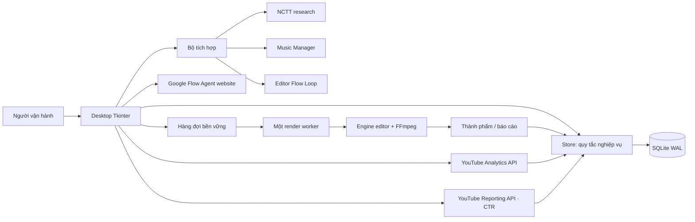
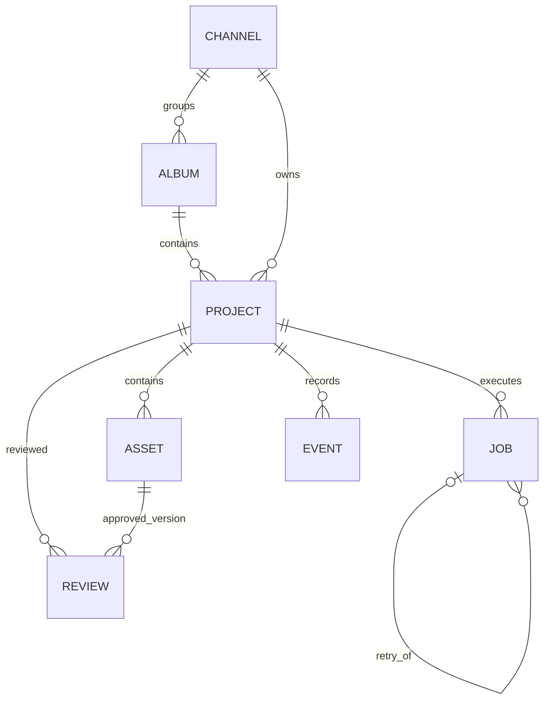

# Quyết định thiết kế và phạm vi triển khai

Ngày thiết kế: 16/10/2026. Người vận hành xác nhận: **một người quản lý nhiều kênh**.

## Bài toán và ý tưởng sản phẩm

Đơn vị quản trị có hai tầng: **album/playlist phát hành** thuộc một kênh, và nhiều
**video/mix** trong album. Mỗi video/mix giữ quy trình, tài nguyên, QC, render và
trạng thái xuất bản riêng. Các tool là bộ phận thực thi; cơ sở dữ liệu và quy tắc
nghiệp vụ mới là lớp quản trị. Dự án cũ chưa gắn album tiếp tục hoạt động độc lập.

Ba câu hỏi cần trả lời ngay trên sản phẩm:

1. Kênh nào đang sản xuất nội dung gì, do ai phụ trách, đang dừng ở bước nào?
2. Video này dùng những nguồn nào và phiên bản nào đã được duyệt?
3. Nếu render lỗi/nguồn thay đổi, có truy được nguyên nhân và thực hiện lại an toàn không?

## Kiến trúc

`app.py` dựng UI và không chứa SQL; `store.py` quản lý dữ liệu, chuyển bước, QC,
phiên bản và audit; `services.py` nối các tool và thực thi job; engine media tiếp tục
dùng mã editor đã có. Không sao chép automation Google Flow vào Hub.

## Mô hình dữ liệu

- **Channel:** tên, ngách, URL, phong cách, trạng thái lưu trữ.
- **Album:** kênh đích, tên đợt phát hành, brief chung và ngày mục tiêu.
- **Project/video:** kênh đích, album tùy chọn, tiêu đề video, brief riêng, người phụ trách,
  deadline, stage, revision, playlist Music Manager riêng, lịch đăng nội bộ và URL được người vận hành xác nhận.
- **Asset:** project, loại, nhóm, version, path, bytes, mtime, SHA-256, ghi chú.
- **Review:** đúng asset thành phẩm, decision, checklist, reviewer, note và thời gian.
- **Job:** snapshot nguồn/cấu hình, lifecycle, tiến trình, kết quả/lỗi, retry_of.
- **Event:** hành động, nhãn người thao tác, project, dữ liệu và thời gian UTC+7.
- **Metric:** snapshot theo lần làm mới, gồm lượt xem, thời gian xem, AVD, tỷ lệ xem,
  comment, like, share và reach; giữ tương thích với các bản ghi chỉ số thủ công cũ.

Playlist nhạc được gắn với từng video/mix sẽ làm nguồn nhạc mặc định cho render video
đó; nếu chưa gắn, luồng render dùng các bài đã gán cho kênh. Album chỉ nhóm đầu ra,
còn playlist, QC và tài nguyên được giữ riêng theo từng video để tránh dùng nhầm nhạc
hoặc duyệt nhầm bản.

## Các quyết định quan trọng

### ADR-01: Desktop và SQLite trước

Phù hợp với máy Windows và các tool Python đang có; không cần deploy server. Analytics
dùng OAuth chỉ đọc, token được giữ trong thư mục dữ liệu cục bộ của người dùng. SQLite WAL cho đọc trong lúc worker ghi; các transaction
nghiệp vụ dùng BEGIN IMMEDIATE và khóa ngoại. Không thiết kế cho nhiều máy ghi qua share.

### ADR-02: Quản trị tách khỏi sinh nội dung

Hub mở NCTT, Music Manager và Tool Edit theo ngữ cảnh. Flow được mở trên website
chính thức, nơi người dùng dùng Agent để sáng tạo. Hub chuẩn bị brief chung của album,
brief riêng của video và danh sách nguồn; người dùng quyết định khi nào tạo nội dung
và nhập kết quả vào đúng video. Mở website không được coi là hoàn thành tác vụ; không
tự gắn file mới nhất trong thư viện vào một dự án.

### ADR-03: Chuyển bước có điều kiện và audit cùng transaction

Lỗi validation không để lại trạng thái nửa chừng. Revision giúp từ chối thao tác
được thực hiện trên màn hình cũ. QC gắn đúng version thành phẩm; thay đầu vào sau
duyệt đưa dự án về dựng. Lịch đăng là kế hoạch nội bộ, không mô phỏng phản hồi YouTube.

### ADR-04: Một worker, job bền vững

Hạn chế RAM và xung đột FFmpeg. Unique partial index ngăn hai job hoạt động cho một
dự án; claim trong transaction. Process lock ngăn hai Hub cùng phục hồi/chạy một DB.
Khởi động lại đánh dấu lượt đang chạy là interrupted, người dùng quyết định thử lại.

### ADR-05: Tham chiếu media và SHA-256

Tránh nhân đôi file nhiều GB. Lưu toàn bộ lịch sử metadata; hash phát hiện nội dung
bị đổi. Đánh đổi: không khôi phục byte của bản cũ nếu file nguồn bị ghi đè. Render
Hub dùng thư mục riêng theo job để giữ các lần tạo thành phẩm.

### ADR-06: Dữ liệu demo tách database

Không tạo kênh/chỉ số giả trong database sản xuất. Báo cáo kiểm thử ngày 16/10/2026 ghi
nhận hai kênh và hai dự án trên bản khi đó. Mã seed trong database demo sạch tạo ba
kênh, sáu album và mười hai video/mix; database demo cũ được giữ nguyên để tránh xóa dữ
liệu, nên có thể còn các mục mẫu hoặc media từ lần chạy trước. Bộ seed là dữ liệu minh
họa giao diện, chưa thay thế bộ dữ liệu thực nghiệm có nguồn gốc được mô tả trong kế
hoạch. Seed chỉ tạo tài nguyên tổng hợp và không tự gắn media tùy ý từ thư mục output.
Thử nghiệm render dùng clip tổng hợp và thư mục tạm, không tiêu thụ Flow.

## Ma trận phạm vi

| Hạng mục | Trạng thái bản đầu |
|---|---|
| Kênh, album/playlist, video/mix con, bộ lọc, brief, deadline | Đã triển khai |
| Quy trình có điều kiện, revision, lịch sử | Đã triển khai |
| Nguồn/phiên bản/hash, QC và yêu cầu sửa | Đã triển khai |
| Mở NCTT, Music Manager, Editor; mở Flow website và xuất handoff | Đã triển khai, chọn/nhập nguồn thủ công |
| Render queue, hủy, lỗi, retry, restart | Đã triển khai, tích hợp engine thực |
| Lịch đăng và xác nhận URL | Đã triển khai, người dùng thực hiện xuất bản |
| Xuất hồ sơ dự án và lịch sử | Đã triển khai |
| Theo dõi video sau đăng | Đã triển khai: OAuth chỉ đọc, snapshot theo yêu cầu và lịch sử trong Hub |
| CTR/impressions | Đã triển khai qua YouTube Reporting API; báo cáo hằng ngày, tối đa 28 ngày có sẵn |
| Tài khoản, RBAC, cộng tác qua mạng | Ngoài phạm vi MVP một người |
| Đăng YouTube tự động | Giai đoạn mở rộng |
| SEO/AI planner/so sánh thumbnail | Giai đoạn mở rộng |
| Đọc kết quả Studio tự động theo mã dự án | Giai đoạn tiếp theo; cần hợp đồng project_id/handoff |

Không dùng bảng này để tuyên bố mọi phân hệ trong đặc tả 1.0 đã hoàn thành. Đặc tả
ban đầu rộng hơn MVP; cần thống nhất phạm vi báo cáo với giảng viên hướng dẫn.
