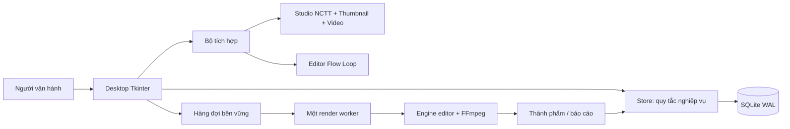
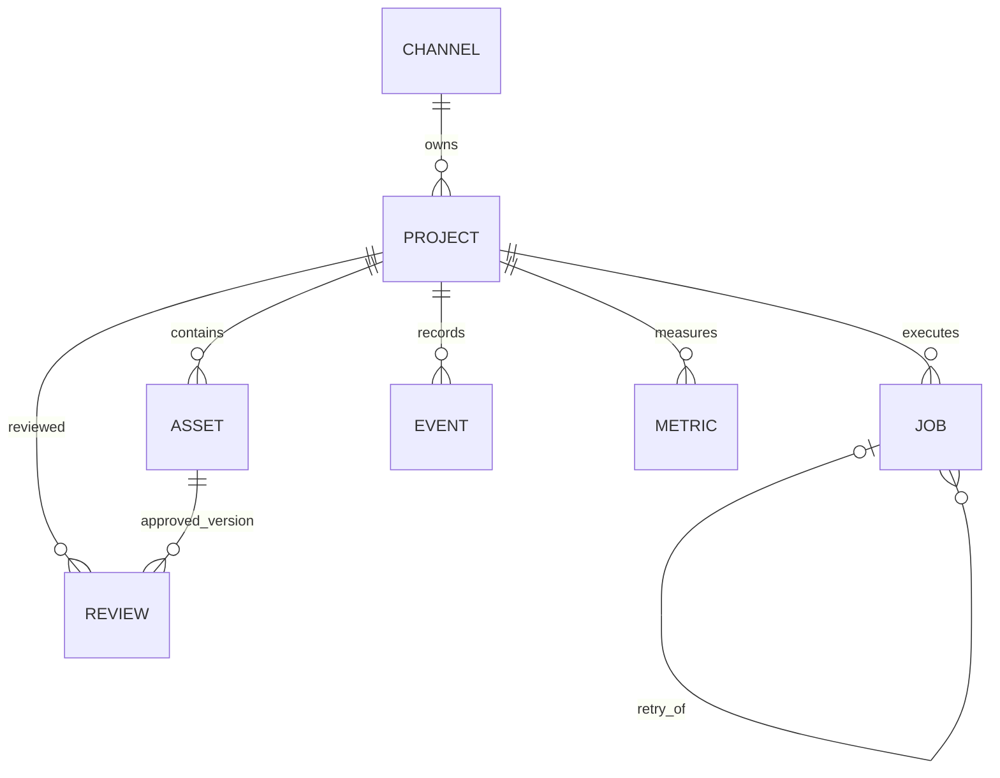

# Quyết định thiết kế và phạm vi triển khai

Ngày thiết kế: 16/10/2026. Người vận hành xác nhận: **một người quản lý nhiều kênh**.

## Bài toán và ý tưởng sản phẩm

Đơn vị quản trị trung tâm là **dự án nội dung**, không phải một file video hoặc một
tool. Mỗi dự án thuộc đúng một kênh và đi qua quy trình có điều kiện chuyển bước.
Các tool là bộ phận thực thi; cơ sở dữ liệu và quy tắc nghiệp vụ mới là lớp quản trị.

Ba câu hỏi cần trả lời ngay trên sản phẩm:

1. Kênh nào đang sản xuất nội dung gì, do ai phụ trách, đang dừng ở bước nào?
2. Video này dùng những nguồn nào và phiên bản nào đã được duyệt?
3. Nếu render lỗi/nguồn thay đổi, có truy được nguyên nhân và thực hiện lại an toàn không?

## Kiến trúc

`app.py` dựng UI và không chứa SQL; `store.py` quản lý dữ liệu, chuyển bước, QC,
phiên bản và audit; `services.py` nối các tool và thực thi job; engine media tiếp tục
dùng mã editor đã có. Không sao chép automation Google Flow vào Hub.

## Mô hình dữ liệu

- **Channel:** tên, ngách, URL, phong cách, trạng thái lưu trữ.
- **Project:** kênh đích, brief, người phụ trách, deadline, stage, revision, lịch đăng, URL.
- **Asset:** project, loại, nhóm, version, path, bytes, mtime, SHA-256, ghi chú.
- **Review:** đúng asset thành phẩm, decision, checklist, reviewer, note và thời gian.
- **Job:** snapshot nguồn/cấu hình, lifecycle, tiến trình, kết quả/lỗi, retry_of.
- **Event:** hành động, nhãn người thao tác, project, dữ liệu và thời gian UTC+7.
- **Metric:** snapshot tích lũy, nguồn manual, thời điểm ghi.

## Các quyết định quan trọng

### ADR-01: Desktop và SQLite trước

Phù hợp với máy Windows và các tool Python đang có; không cần deploy server hoặc
quản lý tài khoản cloud. SQLite WAL cho đọc trong lúc worker ghi; các transaction
nghiệp vụ dùng BEGIN IMMEDIATE và khóa ngoại. Không thiết kế cho nhiều máy ghi qua share.

### ADR-02: Quản trị tách khỏi sinh nội dung

Hub mở đúng launcher của Studio hiện tại. Người dùng quyết định khi nào submit
Flow và chọn tài nguyên nào gắn vào dự án. Không coi mở tool là hoàn thành tác vụ;
không tự gắn file mới nhất trong thư viện vào một dự án.

### ADR-03: Chuyển bước có điều kiện và audit cùng transaction

Lỗi validation không để lại trạng thái nửa chừng. Revision giúp từ chối thao tác
được thực hiện trên màn hình cũ. QC gắn đúng version thành phẩm; thay đầu vào sau
duyệt đưa dự án về dựng. Lịch đăng là kế hoạch nội bộ, không mô phỏng phản hồi YouTube.

### ADR-04: Một worker, job bền vững

Hạn chế RAM và xung đột FFmpeg. Unique partial index ngăn hai job hoạt động cho một
dự án; claim trong transaction. Process lock ngăn hai Hub cùng phục hồi/chạy một DB.
Khởi động lại đánh dấu lượt đang chạy là interrupted, người dùng quyết định thử lại.

### ADR-05: Tham chiếu media và SHA-256

Tránh nhân đôi file nhiều GB. Lưu toàn bộ lịch sử metadata; hash phát hiện nội dung
bị đổi. Đánh đổi: không khôi phục byte của bản cũ nếu file nguồn bị ghi đè. Render
Hub dùng thư mục riêng theo job để giữ các lần tạo thành phẩm.

### ADR-06: Dữ liệu demo tách database

Không tạo kênh/chỉ số giả trong database sản xuất. Demo có nhãn rõ, hai kênh và hai
dự án. Thử nghiệm dùng clip tổng hợp và thư mục tạm, không tiêu thụ Flow.

## Ma trận phạm vi

| Hạng mục | Trạng thái bản đầu |
|---|---|
| Kênh, dự án, bộ lọc, brief, deadline | Đã triển khai |
| Quy trình có điều kiện, revision, lịch sử | Đã triển khai |
| Nguồn/phiên bản/hash, QC và yêu cầu sửa | Đã triển khai |
| Mở Studio/Editor và xuất handoff | Đã triển khai, chọn/nhập nguồn thủ công |
| Render queue, hủy, lỗi, retry, restart | Đã triển khai, tích hợp engine thực |
| Lịch đăng và xác nhận URL | Đã triển khai, người dùng thực hiện xuất bản |
| Snapshot chỉ số và xuất hồ sơ | Đã triển khai, nguồn manual |
| Tài khoản, RBAC, cộng tác qua mạng | Ngoài phạm vi MVP một người |
| Đồng bộ API YouTube và đăng tự động | Giai đoạn mở rộng |
| SEO/AI planner/so sánh thumbnail | Giai đoạn mở rộng |
| Đọc kết quả Studio tự động theo mã dự án | Giai đoạn tiếp theo; cần hợp đồng project_id/handoff |

Không dùng bảng này để tuyên bố mọi phân hệ trong đặc tả 1.0 đã hoàn thành. Đặc tả
ban đầu rộng hơn MVP; cần thống nhất phạm vi báo cáo với giảng viên hướng dẫn.
