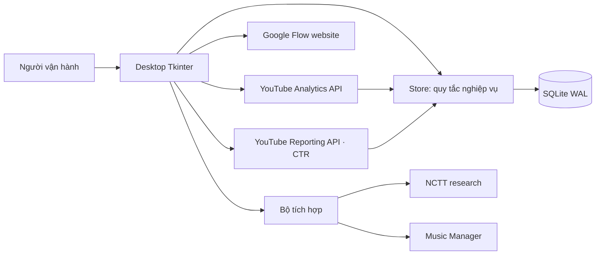
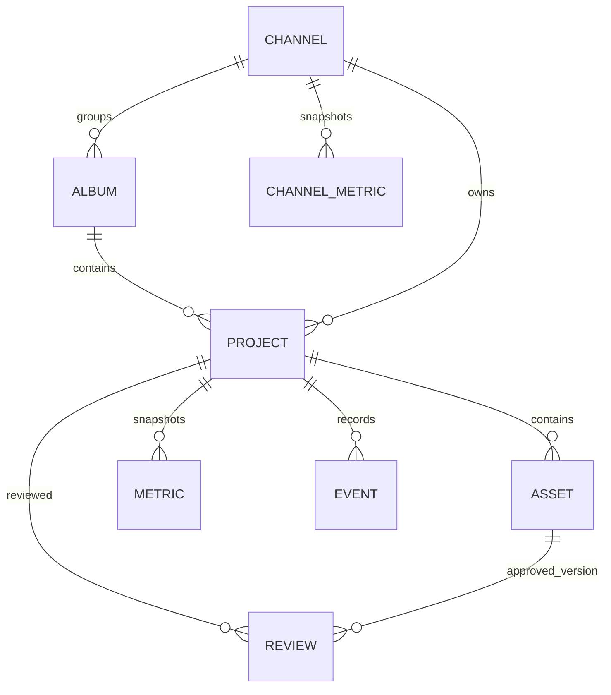

# Quyết định thiết kế và phạm vi triển khai

Ngày cập nhật: 23/11/2026. Người vận hành: **một người quản lý nhiều kênh YouTube**.

## Bài toán và ý tưởng sản phẩm

Đơn vị quản trị có hai tầng: **album/đợt phát hành** thuộc một kênh, và nhiều
**video/mix** trong album. Mỗi video/mix giữ brief, tài nguyên, QC, lịch sử và trạng thái
xuất bản riêng. Hub quản trị quy trình; CapCut, Google Flow, NCTT và Music Manager là các
công cụ thực thi độc lập.

Ba câu hỏi cần trả lời ngay trên sản phẩm:

1. Kênh nào đang sản xuất nội dung gì, do ai phụ trách, đang dừng ở bước nào?
2. Video này dùng những nguồn nào và phiên bản nào đã được duyệt?
3. Sau khi đăng, video/kênh đang có hiệu suất ra sao và số liệu đó được lấy khi nào?

## Kiến trúc

`app.py` dựng UI và không chứa SQL. `store.py` quản lý dữ liệu, chuyển bước, QC, phiên
bản, audit và snapshot Analytics. `services.py` chỉ nối NCTT/Music Manager và chuẩn bị
handoff; Hub không chứa engine render hay FFmpeg.

## Mô hình dữ liệu

- **Channel:** tên, ngách, URL, phong cách, `youtube_channel_id`, lưu trữ.
- **Album:** kênh đích, tên đợt phát hành, brief chung, ngày mục tiêu.
- **Project/video:** kênh đích, album tùy chọn, tiêu đề, brief riêng, người phụ trách,
  deadline, stage, revision, `published_at`, lịch nội bộ và URL YouTube.
- **Asset:** project, loại, nhóm, version, path, bytes, mtime, SHA-256, ghi chú.
- **Review:** đúng asset thành phẩm, decision, checklist, reviewer, note, thời gian.
- **Metric / ChannelMetric:** snapshot theo lần làm mới; lượt xem, thời gian xem, AVD,
  tỷ lệ xem, comment, like, share, reach/CTR và khoảng ngày dữ liệu.
- **Event:** hành động, nhãn người thao tác, project, dữ liệu và thời gian UTC+7.

Album chỉ nhóm đầu ra. Playlist nhạc được quản lý trong Music Manager, không gắn riêng
từng video trong Hub.

## Các quyết định quan trọng

### ADR-01: Desktop và SQLite trước

Phù hợp máy Windows và các tool Python hiện có; không cần server. SQLite WAL cho đọc
trong lúc ghi; transaction nghiệp vụ dùng `BEGIN IMMEDIATE` và khóa ngoại. Không thiết kế
cho nhiều máy ghi qua share mạng.

### ADR-02: Quản trị tách khỏi sinh nội dung

Hub mở NCTT và Music Manager theo ngữ cảnh, mở Google Flow trên website chính thức và
chuẩn bị brief/tài nguyên. Người dùng quyết định khi nào tạo nội dung, biên tập bằng
CapCut và nhập kết quả vào đúng video. Mở website không được coi là hoàn thành tác vụ;
Hub không tự gắn “file mới nhất” vào dự án.

### ADR-03: Workflow linh hoạt có kiểm soát

Nút chuyển bước tuần tự giữ đầy đủ điều kiện: brief, tài nguyên, QC, hash thành phẩm và
URL. Menu chuột phải cho phép đổi Bước tự do để xử lý ngoại lệ vận hành; mọi lần đổi tay
ghi audit với `manual=True` và `override=True`. Revision giúp từ chối thao tác trên màn
hình cũ. QC gắn đúng version thành phẩm; thay file sau duyệt đưa dự án về Dựng video.
Cách này ưu tiên tính dùng được thực tế nhưng vẫn truy vết được ngoại lệ.

### ADR-04: OAuth và snapshot theo từng kênh

Mỗi kênh có một token riêng. Truy vấn dùng `channel==<youtube_channel_id>`, không dùng
`MINE`. Reporting job, token và snapshot đều gắn với kênh; ngắt kết nối một kênh không
ảnh hưởng kênh khác. Ngày bắt đầu Analytics lấy từ `published_at`; nếu thiếu, dùng
`created_at` và cảnh báo. CTR/impressions lấy từ báo cáo hằng ngày nên có thể trễ 1–2 ngày.

### ADR-05: Tham chiếu media và SHA-256

Tránh nhân đôi file nhiều GB. Lưu metadata và hash để phát hiện file nguồn bị đổi. Đánh
đổi: không khôi phục byte của bản cũ nếu file nguồn bị ghi đè; cần giữ bản nguồn riêng.

### ADR-06: Dữ liệu demo tách database

Không tạo kênh/chỉ số giả trong database sản xuất. Database demo sạch có 3 kênh, 6 album,
12 video/mix; seed idempotent, chỉ tạo tài nguyên tổng hợp nhẹ và không phụ thuộc FFmpeg.
Database demo cũ được backup trước khi thay.

## Ma trận phạm vi

| Hạng mục | Trạng thái |
|---|---|
| Kênh, album, video/mix, bộ lọc, brief, deadline | Đã triển khai |
| Quy trình có điều kiện, đổi bước tay có audit, revision, lịch sử | Đã triển khai |
| Nguồn/phiên bản/hash, QC gắn đúng bản, yêu cầu sửa | Đã triển khai |
| Mở NCTT, Music Manager; mở Flow và xuất handoff | Đã triển khai, nhập nguồn thủ công |
| Lịch đăng nội bộ, xác nhận URL và ngày đăng | Đã triển khai; người dùng tự đăng |
| Xuất hồ sơ dự án và audit | Đã triển khai |
| Analytics video và kênh, token riêng 5 kênh | Đã triển khai mã; chờ kiểm chứng credential thật |
| CTR/impressions qua Reporting API | Đã triển khai; báo cáo hằng ngày, tối đa 28 ngày |
| Render/FFmpeg/Tool Edit trong Hub | **Đã bỏ khỏi phạm vi** |
| Playlist nhạc riêng từng video trong Hub | **Đã bỏ khỏi phạm vi** |
| Tài khoản, RBAC, cộng tác qua mạng | Ngoài phạm vi MVP |
| Tự đăng YouTube, SEO/AI planner | Hướng phát triển |

## Giới hạn

- Một người dùng cục bộ; tên người thao tác là nhãn audit, không phải danh tính xác thực.
- Chưa tự đăng YouTube, chưa tự tạo nội dung trên Flow.
- Analytics chỉ đọc; API thật chưa được chạy với credential của người dùng trong phiên phát triển.
- Hash chứng minh file không đổi, không chứng minh nội dung tốt hoặc quyền sử dụng hợp lệ.
- Schema hiện tại là 6; migration giữ tương thích database cũ nhưng không xóa cột legacy.
