# ĐẶC TẢ HỆ THỐNG  
## Hệ thống quản trị quy trình sản xuất nội dung trên nhiều kênh YouTube

**Tên đề tài:** Phát triển hệ thống quản trị quy trình sản xuất nội dung trên nhiều kênh YouTube  
**Phiên bản tài liệu:** 1.0  
**Loại tài liệu:** Đặc tả yêu cầu hệ thống / Use Case Specification  
**Ngày cập nhật:** 07/09/2026  

---

# 1. Giới thiệu

## 1.1. Bối cảnh

Trong môi trường vận hành nhiều kênh YouTube, quy trình sản xuất nội dung thường bao gồm nhiều giai đoạn như:

- Xây dựng hoạt động ban đầu cho kênh.
- Nghiên cứu thị trường và đối thủ.
- Xây dựng ý tưởng nội dung.
- Thiết kế thumbnail.
- Tiếp nhận và kiểm duyệt video từ đội Editor.
- Tối ưu SEO cho kênh và từng video.
- Lập lịch và đăng video.
- Theo dõi hiệu suất video.
- Phân tích dữ liệu và đưa ra kế hoạch cho chu kỳ tiếp theo.

Hiện nay các công việc này thường được thực hiện rời rạc trên nhiều công cụ như Google Sheets, Notion, YouTube Studio, vidIQ, ChatGPT, Grok, Google Flow, Photoshop và các công cụ AI khác.

Điều này dẫn đến các vấn đề:

- Dữ liệu phân tán.
- Khó theo dõi trạng thái của từng video.
- Nhiều thao tác lặp lại.
- Khó quản lý nhiều kênh cùng lúc.
- Khó lưu lịch sử thay đổi thumbnail và SEO.
- Khó đánh giá chính xác nguyên nhân video hiệu quả hoặc kém hiệu quả.
- Việc lập kế hoạch tuần tiếp theo phụ thuộc nhiều vào kinh nghiệm cá nhân.
- Chưa tận dụng tốt AI và dữ liệu lịch sử để hỗ trợ ra quyết định.

---

# 2. Mục tiêu hệ thống

Hệ thống được xây dựng nhằm:

1. Quản lý tập trung nhiều kênh YouTube.
2. Chuẩn hóa quy trình sản xuất nội dung.
3. Giảm thao tác thủ công và công việc lặp lại.
4. Hỗ trợ nghiên cứu thị trường bằng dữ liệu.
5. Hỗ trợ tạo thumbnail bằng AI.
6. Hỗ trợ tối ưu SEO cho kênh và video.
7. Quản lý trạng thái video xuyên suốt vòng đời sản xuất.
8. Thu thập và phân tích dữ liệu hiệu suất.
9. Tạo báo cáo định kỳ.
10. Đề xuất chiến lược nội dung cho tuần tiếp theo.
11. Hình thành vòng lặp học liên tục giữa dữ liệu thị trường và dữ liệu hiệu suất nội bộ.

---

# 3. Phạm vi hệ thống

Hệ thống được chia thành các phân hệ chính:

| Mã | Phân hệ | Mức độ triển khai |
|---|---|---|
| M0 | Quản trị người dùng và kênh | BUILD |
| M1 | Hỗ trợ hoạt động kênh ban đầu | BUILD |
| M2 | Nghiên cứu thị trường | BUILD |
| M3 | Sản xuất thumbnail bằng AI | BUILD |
| M4 | Quản lý duyệt video | Workflow thủ công |
| M5 | SEO kênh và video | BUILD |
| M6 | Quản lý lịch đăng video | Workflow thủ công |
| M7 | Analytics và lập kế hoạch | BUILD |

---

# 4. Nguyên tắc thiết kế

## 4.1. Closed-loop Content Operation

Hệ thống được thiết kế theo vòng lặp:

```text
MARKET RESEARCH
      ↓
MARKET INSIGHT
      ↓
CONTENT IDEA
      ↓
THUMBNAIL
      ↓
VIDEO QC
      ↓
SEO
      ↓
PUBLISH
      ↓
ANALYTICS
      ↓
WEEKLY REVIEW
      ↓
NEXT WEEK PLAN
      ↓
MARKET / CONTENT IDEA
```

Kết quả từ video cũ phải trở thành dữ liệu đầu vào cho quyết định nội dung mới.

---

## 4.2. Phân loại chức năng

Hệ thống chia chức năng thành ba nhóm:

### A. Intelligent Module

Có sử dụng AI hoặc automation:

- Phân tích xu hướng.
- Sinh market insight.
- Sinh prompt.
- Sinh thumbnail.
- Phân tích keyword.
- Sinh metadata SEO.
- Đánh giá SEO.
- Phân tích hiệu suất.
- Sinh báo cáo tuần.
- Đề xuất kế hoạch tuần tiếp theo.

### B. Workflow Module

Hệ thống quản lý quy trình nhưng con người thực hiện:

- Duyệt video.
- Yêu cầu Editor chỉnh sửa.
- Duyệt thumbnail.
- Lập lịch đăng.
- Xác nhận video đã đăng.

### C. External Integration

Tích hợp dịch vụ bên ngoài:

- YouTube.
- AI Provider.
- Google Trends.
- Nguồn dữ liệu thị trường.
- Các dịch vụ phân tích SEO nếu cần.

---

# 5. Lưu ý về hoạt động kênh ban đầu

Hệ thống **không nên tự động tạo view, like, comment nhằm thao túng chỉ số hoặc giả lập người dùng thật**.

Phân hệ này nên được xây dựng theo hướng:

- Tìm nội dung đúng chủ đề.
- Gợi ý video nên nghiên cứu.
- Gợi ý nội dung phản hồi.
- Lập kế hoạch tương tác.
- Ghi nhận lịch sử hoạt động.
- Người dùng duyệt và thực hiện thao tác tương tác.

Tên đề xuất:

> **Module hỗ trợ hoạt động kênh và nghiên cứu cộng đồng**

---

# 6. Actor của hệ thống

## 6.1. Content Staff

Người trực tiếp quản trị kênh và thực hiện:

- Nghiên cứu thị trường.
- Quản lý ý tưởng.
- Tạo thumbnail.
- Duyệt video.
- SEO.
- Lập lịch.
- Theo dõi hiệu suất.

---

## 6.2. Editor

Thực hiện:

- Gửi video.
- Gửi tracklist.
- Nhận yêu cầu chỉnh sửa.
- Cập nhật phiên bản video.

---

## 6.3. Team Leader / Manager

Thực hiện:

- Theo dõi toàn bộ kênh.
- Duyệt thumbnail hoặc chiến lược.
- Xem báo cáo.
- Duyệt kế hoạch tuần.
- Đánh giá hiệu suất.

---

## 6.4. Administrator

Thực hiện:

- Quản lý tài khoản.
- Quản lý role.
- Quản lý quyền.
- Quản lý channel.
- Cấu hình hệ thống.

---

## 6.5. YouTube

Hệ thống bên ngoài cung cấp dữ liệu:

- Channel.
- Video.
- Analytics.
- Comment.
- Metadata.

---

## 6.6. External Market Sources

Các nguồn bên ngoài:

- Dữ liệu đối thủ.
- Google Trends.
- Các nền tảng xã hội.
- Các nguồn public market data khác.

---

## 6.7. AI Services

Bao gồm các model AI có thể thay đổi theo thời gian.

Ví dụ:

- GPT.
- Grok.
- Google.
- Các model nội bộ hoặc dịch vụ khác.

---

# 7. Sơ đồ Use Case tổng thể

```plantuml
@startuml
left to right direction

actor "Content Staff" as Content
actor "Editor" as Editor
actor "Team Leader" as Manager
actor "Administrator" as Admin

actor "YouTube" as YT
actor "Nguồn dữ liệu\nthị trường" as Market
actor "AI Services" as AI

rectangle "HỆ THỐNG QUẢN TRỊ QUY TRÌNH\nSẢN XUẤT NỘI DUNG YOUTUBE" {

    package "M0. Quản trị hệ thống" {
        usecase "UC01\nĐăng nhập" as UC01
        usecase "UC02\nQuản lý người dùng\n& phân quyền" as UC02
        usecase "UC03\nQuản lý kênh YouTube" as UC03
    }

    package "M1. Hoạt động kênh" {
        usecase "UC04\nQuản lý kế hoạch\nhoạt động kênh" as UC04
        usecase "UC05\nGợi ý nội dung\nđúng chủ đề" as UC05
        usecase "UC06\nGợi ý phản hồi /\nbình luận" as UC06
        usecase "UC07\nGhi nhận lịch sử\nhoạt động" as UC07
    }

    package "M2. Nghiên cứu thị trường" {
        usecase "UC08\nQuản lý đối thủ" as UC08
        usecase "UC09\nThu thập dữ liệu\nthị trường" as UC09
        usecase "UC10\nPhân tích xu hướng" as UC10
        usecase "UC11\nSinh Market Insight" as UC11
    }

    package "M3. Thumbnail AI" {
        usecase "UC12\nQuản lý concept\nthumbnail" as UC12
        usecase "UC13\nSinh prompt AI" as UC13
        usecase "UC14\nSinh thumbnail" as UC14
        usecase "UC15\nQuản lý phiên bản\nthumbnail" as UC15
        usecase "UC16\nDuyệt thumbnail" as UC16
    }

    package "M4. Video QC" {
        usecase "UC17\nTiếp nhận video\nEditor" as UC17
        usecase "UC18\nDuyệt video" as UC18
        usecase "UC19\nQuản lý tracklist" as UC19
        usecase "UC20\nYêu cầu chỉnh sửa" as UC20
    }

    package "M5. SEO" {
        usecase "UC21\nNghiên cứu keyword" as UC21
        usecase "UC22\nSinh SEO metadata" as UC22
        usecase "UC23\nĐánh giá SEO" as UC23
        usecase "UC24\nQuản lý phiên bản\nSEO" as UC24
    }

    package "M6. Publishing" {
        usecase "UC25\nLập lịch đăng" as UC25
        usecase "UC26\nKiểm tra trước đăng" as UC26
        usecase "UC27\nGhi nhận video\nđã đăng" as UC27
    }

    package "M7. Analytics & Planning" {
        usecase "UC28\nThu thập Analytics" as UC28
        usecase "UC29\nPhân tích hiệu suất" as UC29
        usecase "UC30\nSinh báo cáo tuần" as UC30
        usecase "UC31\nĐề xuất kế hoạch\ntuần tiếp theo" as UC31
    }
}

Content --> UC01
Content --> UC03
Content --> UC04
Content --> UC08
Content --> UC10
Content --> UC12
Content --> UC16
Content --> UC18
Content --> UC19
Content --> UC21
Content --> UC22
Content --> UC25
Content --> UC26
Content --> UC29

Editor --> UC17
Editor --> UC20

Manager --> UC11
Manager --> UC16
Manager --> UC30
Manager --> UC31

Admin --> UC02
Admin --> UC03

Market --> UC09
YT --> UC28

AI --> UC05
AI --> UC06
AI --> UC10
AI --> UC11
AI --> UC13
AI --> UC14
AI --> UC22
AI --> UC23
AI --> UC29
AI --> UC30
AI --> UC31

UC08 .> UC09 : <<include>>
UC09 .> UC10 : <<include>>
UC10 .> UC11 : <<include>>

UC12 .> UC13 : <<include>>
UC13 .> UC14 : <<include>>
UC14 .> UC15 : <<include>>

UC17 .> UC18 : <<include>>
UC18 .> UC20 : <<extend>>

UC21 .> UC22 : <<include>>
UC22 .> UC23 : <<include>>
UC22 .> UC24 : <<include>>

UC25 .> UC26 : <<include>>

UC28 .> UC29 : <<include>>
UC29 .> UC30 : <<include>>
UC30 .> UC31 : <<include>>

@enduml
```



---

# 8. Danh sách Use Case

| ID | Use Case | Actor chính | Loại |
|---|---|---|---|
| UC01 | Đăng nhập | User | Core |
| UC02 | Quản lý user và role | Admin | Core |
| UC03 | Quản lý channel | Admin, Content | Core |
| UC04 | Quản lý kế hoạch hoạt động kênh | Content | Workflow |
| UC05 | Gợi ý nội dung phù hợp niche | Content, AI | AI |
| UC06 | Gợi ý phản hồi cộng đồng | Content, AI | AI |
| UC07 | Theo dõi lịch sử hoạt động | Content | Workflow |
| UC08 | Quản lý competitor | Content | Core |
| UC09 | Thu thập market data | System | Automation |
| UC10 | Phân tích trend | AI | AI |
| UC11 | Sinh market insight | AI, Manager | AI |
| UC12 | Quản lý thumbnail concept | Content | Core |
| UC13 | Sinh prompt | AI | AI |
| UC14 | Sinh thumbnail | AI | AI |
| UC15 | Quản lý thumbnail version | Content | Core |
| UC16 | Duyệt thumbnail | Content, Manager | Workflow |
| UC17 | Nhận video Editor | Editor | Workflow |
| UC18 | Duyệt video | Content | Manual |
| UC19 | Quản lý tracklist | Content | Core |
| UC20 | Yêu cầu Editor sửa | Content | Workflow |
| UC21 | Phân tích keyword | AI, Content | AI |
| UC22 | Sinh metadata | AI | AI |
| UC23 | Đánh giá SEO | AI | AI |
| UC24 | Quản lý metadata version | Content | Core |
| UC25 | Lập lịch đăng | Content | Workflow |
| UC26 | Kiểm tra trước đăng | Content | Workflow |
| UC27 | Xác nhận đã đăng | Content | Manual |
| UC28 | Thu thập analytics | System | Automation |
| UC29 | Đánh giá hiệu suất | AI | AI |
| UC30 | Sinh báo cáo tuần | AI, System | AI |
| UC31 | Đề xuất kế hoạch tuần tới | AI, Manager | AI |

---

# 9. Đặc tả Use Case chi tiết

---

## UC01 – Đăng nhập

### Mục tiêu
Cho phép người dùng truy cập hệ thống theo đúng quyền được cấp.

### Actor
- Content Staff.
- Editor.
- Manager.
- Administrator.

### Tiền điều kiện
- Người dùng có tài khoản hợp lệ.

### Luồng chính
1. Người dùng nhập tài khoản và mật khẩu.
2. Hệ thống kiểm tra thông tin.
3. Hệ thống xác định role.
4. Hệ thống tạo phiên đăng nhập.
5. Hiển thị Dashboard tương ứng.

### Ngoại lệ
- Sai tài khoản hoặc mật khẩu.
- Tài khoản bị khóa.
- Không có quyền truy cập.

### Hậu điều kiện
Người dùng truy cập được các chức năng được phân quyền.

---

## UC02 – Quản lý người dùng và phân quyền

### Actor
Administrator.

### Mục tiêu
Quản lý user, role và quyền truy cập.

### Chức năng
- Tạo user.
- Sửa user.
- Khóa user.
- Gán role.
- Gán channel.
- Phân quyền module.

### Role đề xuất
- Admin.
- Manager.
- Content Staff.
- Editor.
- Viewer.

---

## UC03 – Quản lý kênh YouTube

### Actor
- Administrator.
- Content Staff.

### Mục tiêu
Quản lý tập trung thông tin các kênh YouTube.

### Dữ liệu
- Channel ID.
- Tên kênh.
- URL.
- Niche.
- Quốc gia.
- Ngôn ngữ.
- Người phụ trách.
- Trạng thái.
- Ngày bắt đầu.
- Ghi chú.

### Luồng chính
1. Người dùng mở danh sách channel.
2. Hệ thống hiển thị các kênh được phép xem.
3. Người dùng chọn thêm hoặc sửa.
4. Nhập thông tin.
5. Hệ thống kiểm tra dữ liệu.
6. Lưu channel.
7. Hiển thị thông báo thành công.

### Ngoại lệ
- Channel ID đã tồn tại.
- Dữ liệu không hợp lệ.
- Người dùng không có quyền.

---

# 10. Module hỗ trợ hoạt động kênh

## UC04 – Quản lý kế hoạch hoạt động kênh

### Mục tiêu
Quản lý lịch hoạt động và nghiên cứu nội dung cho các kênh mới hoặc đang phát triển.

### Dữ liệu
- Channel.
- Ngày.
- Niche.
- Danh sách nội dung đề xuất.
- Loại hoạt động.
- Trạng thái.
- Người thực hiện.

### Luồng
1. Content chọn channel.
2. Hệ thống hiển thị kế hoạch.
3. Content xem danh sách nội dung liên quan.
4. Content thực hiện hoạt động thủ công.
5. Ghi nhận hoàn thành.

---

## UC05 – Gợi ý nội dung đúng chủ đề

### Mục tiêu
Hỗ trợ Content tìm video, chủ đề hoặc cộng đồng phù hợp với niche.

### Input
- Channel niche.
- Quốc gia.
- Ngôn ngữ.
- Keyword.
- Dữ liệu thị trường.

### Output
Danh sách nội dung phù hợp để nghiên cứu hoặc tương tác.

---

## UC06 – Gợi ý phản hồi cộng đồng

### Mục tiêu
AI đề xuất nội dung phản hồi phù hợp với ngữ cảnh.

### Nguyên tắc
AI chỉ **gợi ý**, người dùng quyết định nội dung và thao tác cuối cùng.

---

## UC07 – Ghi nhận lịch sử hoạt động

### Dữ liệu
- Channel.
- Thời gian.
- Nội dung.
- Loại hoạt động.
- Người thực hiện.
- Ghi chú.

---

# 11. Module nghiên cứu thị trường

## UC08 – Quản lý đối thủ

### Mục tiêu
Xây dựng danh sách competitor theo niche.

### Dữ liệu
- Channel ID.
- Tên channel.
- Niche.
- Quốc gia.
- Ngôn ngữ.
- Subscribers.
- Nhóm quy mô.
- Trạng thái theo dõi.

### Nhóm đề xuất
- Small Channel.
- Medium Channel.
- Large Channel.

---

## UC09 – Thu thập dữ liệu thị trường

### Actor
System, External Market Sources.

### Mục tiêu
Tự động tổng hợp dữ liệu phục vụ nghiên cứu.

### Input
- Niche.
- Quốc gia.
- Ngôn ngữ.
- Khoảng thời gian.
- Số lượng mẫu.
- Danh sách competitor.

### Dữ liệu cần thu thập
- Channel.
- Subscribers.
- Views.
- Video.
- Title.
- Publish Date.
- Publish Time.
- Duration.
- Language.
- Country.
- Thumbnail.
- Keywords.
- Likes.
- Comments.
- Views velocity.
- Upload frequency.

### Luồng chính
1. Người dùng chọn niche.
2. Chọn thị trường.
3. Chọn phạm vi thời gian.
4. Chọn số lượng kênh.
5. Hệ thống thu thập dữ liệu.
6. Chuẩn hóa dữ liệu.
7. Loại dữ liệu trùng.
8. Phân nhóm channel.
9. Lưu Market Snapshot.
10. Chuyển dữ liệu sang UC10.

### Hậu điều kiện
Tạo được Market Dataset.

---

## UC10 – Phân tích xu hướng

### Mục tiêu
Phát hiện pattern và xu hướng từ dữ liệu thị trường.

### Input
Market Dataset.

### Các nhóm phân tích
- Title.
- Keyword.
- Duration.
- Publish time.
- Thumbnail.
- View velocity.
- Engagement.
- Content format.

### Output mẫu

```text
Trend ID: TR-001
Niche: Christmas Music
Market: US
Trend: Children Choir + Cathedral
Growth: High
Views Velocity: +42% so với median
Title Keywords:
- Christmas Carols
- Traditional Christmas
- Christmas Choir
Confidence: 82%
```

### Luồng chính
1. Nhận dữ liệu UC09.
2. Chuẩn hóa metric.
3. Phân tích pattern.
4. Phát hiện nhóm tăng trưởng.
5. AI diễn giải insight.
6. Lưu Trend Record.

---

## UC11 – Sinh Market Insight

### Mục tiêu
Chuyển kết quả phân tích thành đề xuất có thể hành động.

### Phân loại
- Trend Opportunity.
- White-space Opportunity.
- Stable Pattern.
- Declining Pattern.

### Output mẫu

```text
Type: Trend
Target: Soft Rock US
Observation:
Thumbnail couple 40–50 tuổi đang có CTR tốt hơn nhóm landscape.

Recommended Action:
Test 3 thumbnail couple close-up trong tuần tiếp theo.

Priority: HIGH
Confidence: 84%
```

---

# 12. Module Thumbnail AI

## UC12 – Quản lý concept thumbnail

### Dữ liệu
- Project ID.
- Channel.
- Concept.
- Strategy.
- Market Reference.
- Target Audience.
- Style.
- Status.

### Strategy
- Follow Market Trend.
- Creative Niche.
- Hybrid.

---

## UC13 – Sinh Prompt AI

### Actor
Content Staff, AI Services.

### Input

```text
Market Insight
+ Channel Style
+ Creative Direction
+ Historical Winner
+ Thumbnail Requirement
```

### Output
Prompt tạo ảnh.

### Luồng
1. Content chọn project.
2. Chọn strategy.
3. Hệ thống lấy dữ liệu liên quan.
4. AI sinh prompt.
5. Content chỉnh prompt nếu cần.
6. Lưu phiên bản prompt.

---

## UC14 – Sinh Thumbnail

### Mục tiêu
Tạo ảnh thumbnail bằng nhiều AI Provider khác nhau.

### Input
- Prompt.
- Reference Image.
- Aspect Ratio.
- Provider.
- Model.
- Style.

### Kiến trúc provider đề xuất

```text
AI IMAGE SERVICE
       |
  +----+----+------+
  |         |      |
 GPT       Grok  Google
```

### Dữ liệu cần lưu
- Provider.
- Model.
- Prompt.
- Parameters.
- Result URL.
- Generation Time.
- Estimated Cost.
- Created At.

### Luồng
1. Content chọn prompt.
2. Chọn AI provider.
3. Gửi yêu cầu tạo ảnh.
4. Nhận kết quả.
5. Lưu file.
6. Tạo Thumbnail Version.
7. Content có thể regenerate hoặc chỉnh sửa ngoài hệ thống.
8. Upload bản hoàn thiện nếu cần.

---

## UC15 – Quản lý phiên bản thumbnail

### Mục tiêu
Theo dõi toàn bộ lịch sử chỉnh sửa thumbnail.

### Trạng thái
- DRAFT.
- GENERATED.
- EDITING.
- REVIEW.
- APPROVED.
- REJECTED.
- PUBLISHED.

### Dữ liệu
- Version Number.
- Image.
- Prompt.
- Provider.
- Model.
- Creator.
- Created Date.
- Status.
- Notes.
- CTR sau khi sử dụng.

---

## UC16 – Duyệt thumbnail

### Actor
Content Staff, Manager.

### Luồng
1. Mở danh sách thumbnail version.
2. So sánh các phiên bản.
3. Chọn:
   - Approve.
   - Reject.
   - Request Revision.
4. Nếu Approve, hệ thống đánh dấu thumbnail chính thức.

### Ràng buộc
Mỗi Content Project chỉ có tối đa một thumbnail ở trạng thái APPROVED tại một thời điểm.

---

# 13. Module Video QC

## UC17 – Tiếp nhận video từ Editor

### Actor
Editor.

### Input
- Project ID.
- Video.
- Version.
- Tracklist.
- Ghi chú.

### Output
Project chuyển sang trạng thái VIDEO_RECEIVED.

---

## UC18 – Duyệt video

### Actor
Content Staff.

### Mục tiêu
Kiểm duyệt thủ công video.

### Checklist đề xuất

#### Technical
- Resolution đúng.
- Không lỗi render.
- Không black frame.
- Audio hoạt động.
- Duration hợp lệ.
- Intro đúng.
- Outro đúng.

#### Content
- Tracklist đúng.
- Không trùng nhạc.
- Thứ tự đúng.
- Thumbnail phù hợp nội dung.
- Không có lỗi nội dung rõ ràng.

### Luồng

```text
EDITOR
  ↓
VIDEO RECEIVED
  ↓
MANUAL QC
  ├── FAIL → REVISION → EDITOR
  └── PASS → SEO
```

---

## UC19 – Quản lý Tracklist

### Dữ liệu
- Track.
- Artist.
- Timestamp.
- Duration.
- Position.
- Source.
- Copyright Status.

### Cấu trúc ví dụ

| # | Track | Artist | Timestamp |
|---:|---|---|---|
| 1 | Song A | Artist A | 00:00 |
| 2 | Song B | Artist B | 04:15 |

### Mục đích
Tracklist được sử dụng làm input cho:
- Description.
- Chapter.
- Title.
- Tags.
- Keyword.

---

## UC20 – Yêu cầu Editor chỉnh sửa

### Actor
Content Staff.

### Luồng
1. QC Fail.
2. Content nhập lý do.
3. Hệ thống tạo Revision Request.
4. Editor nhận thông báo.
5. Editor upload phiên bản mới.
6. Hệ thống tăng Video Version.
7. Quay lại UC18.

---

# 14. Module SEO

## UC21 – Phân tích Keyword

### Input
- Channel.
- Niche.
- Market.
- Competitor.
- Previous Videos.
- Market Trends.
- Tracklist.

### Output
- Primary Keyword.
- Secondary Keyword.
- Long-tail Keyword.
- Trending Keyword.
- Song Keyword.
- Excluded Keyword.

### Dữ liệu Keyword
- keyword.
- source.
- frequency.
- trend.
- relevance_score.
- created_at.

---

## UC22 – Sinh SEO Metadata

### Actor
Content Staff, AI.

### Input

```text
Channel SEO Profile
+ Video Content
+ Tracklist
+ Market Insight
+ Keyword Set
+ Previous Metadata
```

### Output
- Title.
- Description.
- Tags.
- Hashtags.
- Pinned Comment Draft.

### Luồng
1. Content chọn video.
2. Hệ thống lấy dữ liệu.
3. AI sinh nhiều phương án.
4. Content chọn hoặc chỉnh sửa.
5. Lưu metadata version.
6. Chuyển UC23.

---

## UC23 – Đánh giá SEO

### Mục tiêu
Chấm điểm metadata theo bộ tiêu chí nội bộ.

### Điểm gợi ý

| Thành phần | Trọng số |
|---|---:|
| Keyword relevance | 25 |
| Title quality | 20 |
| Description quality | 15 |
| Keyword coverage | 15 |
| Market relevance | 15 |
| Historical performance | 10 |
| **Tổng** | **100** |

### Output mẫu

```text
SEO SCORE: 86/100

Problems:
- Primary keyword xuất hiện chưa sớm.
- Title hơi dài.
- Thiếu keyword relevance cao.

Suggestions:
- Rút ngắn title.
- Đưa primary keyword lên đầu.
- Bổ sung keyword X, Y.
```

---

## UC24 – Quản lý Metadata Version

### Mục tiêu
Theo dõi lịch sử thay đổi SEO.

### Dữ liệu
- Old Value.
- New Value.
- Changed By.
- Changed Time.
- Reason.
- Performance Before.
- Performance After.

### Ví dụ

```text
09/09
TITLE V1
CTR: 3.8%

11/09
TITLE V2
CTR: 5.1%

14/09
TITLE V3
CTR: 5.4%
```

---

# 15. Module Publishing

## UC25 – Lập lịch đăng

### Dữ liệu
- Video.
- Channel.
- Publish Date.
- Publish Time.
- Timezone.
- Status.

### Trạng thái
- DRAFT.
- READY.
- SCHEDULED.
- PUBLISHED.
- CANCELLED.

---

## UC26 – Kiểm tra trước đăng

### Checklist

```text
Video QC        ✓
Thumbnail       ✓
Title           ✓
Description     ✓
Tags            ✓
Tracklist       ✓
Publish Time    ✓
```

Nếu thiếu bất kỳ mục bắt buộc:

```text
NOT READY
```

Nếu đầy đủ:

```text
READY TO PUBLISH
```

---

## UC27 – Xác nhận video đã đăng

### Actor
Content Staff.

### Mục tiêu
Ghi nhận trạng thái publish khi người dùng đăng video thủ công.

### Dữ liệu
- YouTube Video ID.
- URL.
- Publish Time.
- Channel.
- Thumbnail Version.
- Metadata Version.

---

# 16. Module Analytics và Planning

## UC28 – Thu thập Analytics

### Actor
System, YouTube.

### Mục tiêu
Thu thập dữ liệu hiệu suất theo thời gian.

### Mốc snapshot đề xuất
- 1 giờ.
- 6 giờ.
- 24 giờ.
- 3 ngày.
- 7 ngày.
- 14 ngày.
- 28 ngày.

### Metrics
- Views.
- Impressions.
- CTR.
- Watch Time.
- Average View Duration.
- Retention.
- Subscribers Gained.
- Likes.
- Comments.
- Traffic Sources.
- Browse contribution.
- Suggested contribution.
- Search contribution.
- Revenue nếu có quyền truy cập.

---

## UC29 – Phân tích hiệu suất

### Mục tiêu
Đánh giá video dựa trên benchmark của chính channel.

### Nguyên tắc
Không đánh giá bằng số tuyệt đối đơn lẻ.

Ví dụ:

```text
Video CTR: 6.8%
Channel Median CTR: 4.2%
CTR Index: +62%

Video Views 24h: 32,000
Channel Median 24h: 12,500
Velocity Index: 2.56X
```

### Phân loại
- BREAKOUT.
- WINNER.
- NORMAL.
- WEAK.
- UNDERPERFORM.

### Input
- Current Video Metrics.
- Channel Baseline.
- Historical Videos.
- Thumbnail Version.
- SEO Version.
- Publish Time.
- Market Data.

### Output
- Performance Classification.
- Điểm mạnh.
- Điểm yếu.
- Nguyên nhân có khả năng ảnh hưởng.
- Đề xuất hành động.

---

## UC30 – Sinh báo cáo tuần

### Trigger
Cuối chu kỳ báo cáo.

### Input
- 7-day Analytics.
- Publishing History.
- Thumbnail Performance.
- SEO Performance.
- Market Trends.
- Comment Signals.

### Output

```text
CHANNEL: Soft Rock 01

Videos Published: 7
Views: +14%
CTR: 5.8%
Watch Time: +21%
Subscribers: +4.2%

Winner:
Video 028
Views Velocity: 2.7X
CTR: 7.1%

Underperformer:
Video 031
CTR: 2.8%
```

---

## UC31 – Đề xuất kế hoạch tuần tiếp theo

### Actor
AI, Manager.

### Input

```text
MARKET
+
LAST WEEK VIDEOS
+
THUMBNAIL PERFORMANCE
+
SEO PERFORMANCE
+
AUDIENCE BEHAVIOR
```

### Output mẫu

```text
NEXT WEEK PLAN

CONTENT
- 3 Soft Rock Couple
- 2 Romantic Classics
- 2 Experimental Concepts

THUMBNAIL
- Test close-up.
- Reduce yellow tone.
- Test red dress concept.

SEO
- Prioritize "Romantic Classics".
- Test shorter titles.

PUBLISH
- Continue testing 20:00–21:00.

EXPERIMENT
- Close-up vs medium shot.
```

### Manager Actions
- APPROVE.
- EDIT.
- REJECT.

### Hậu điều kiện
Kế hoạch được dùng làm input cho chu kỳ sản xuất tiếp theo.

---

# 17. Trạng thái Content Project

Một video nên có một mã duy nhất xuyên suốt hệ thống.

Ví dụ:

```text
SR01-2026-0098
```

### State Flow

```text
IDEA
↓
RESEARCHING
↓
IDEA_APPROVED
↓
THUMBNAIL_MAKING
↓
THUMBNAIL_APPROVED
↓
WAITING_EDITOR
↓
VIDEO_RECEIVED
↓
QC
↓
QC_PASSED
↓
SEO_READY
↓
READY_TO_PUBLISH
↓
SCHEDULED
↓
PUBLISHED
↓
MONITORING
↓
REVIEWED
```

### Nhánh ngoại lệ

```text
QC_FAILED
THUMBNAIL_REWORK
SEO_REWORK
VIDEO_REWORK
```

---

# 18. Data Model sơ bộ

Các entity chính:

```text
USER
ROLE
TEAM

CHANNEL
CHANNEL_STRATEGY

COMPETITOR_CHANNEL
COMPETITOR_VIDEO
MARKET_SNAPSHOT
MARKET_INSIGHT

CONTENT_IDEA
CONTENT_PROJECT

THUMBNAIL
THUMBNAIL_VERSION
PROMPT

VIDEO_ASSET
VIDEO_VERSION

MUSIC_TRACK
VIDEO_TRACK

QC_REPORT
REVISION_REQUEST

SEO_PROFILE
KEYWORD
SEO_METADATA
METADATA_VERSION

PUBLISH_SCHEDULE

YOUTUBE_VIDEO
VIDEO_METRIC_SNAPSHOT

COMMENT
WEEKLY_REPORT
ACTION_PLAN
EXPERIMENT
```

### Quan hệ trung tâm

```text
CHANNEL
  |
  └── CONTENT_PROJECT
        |
        ├── THUMBNAIL_VERSION
        ├── VIDEO_VERSION
        ├── QC_REPORT
        ├── TRACKLIST
        ├── METADATA_VERSION
        ├── PUBLISH_SCHEDULE
        └── VIDEO_METRIC_SNAPSHOT
```

---

# 19. Thiết kế Analytics Snapshot

Không nên lưu:

```text
video.views = 50000
video.ctr = 5%
```

Nên lưu theo thời điểm:

```text
VIDEO_METRIC_SNAPSHOT

video_id
snapshot_at
views
impressions
ctr
watch_time
average_view_duration
retention
likes
comments
subscriber_gain
traffic_source
```

Ví dụ:

| Time | Views | CTR |
|---|---:|---:|
| 09/09 09:00 | 10,000 | 6.1% |
| 10/09 09:00 | 28,000 | 5.8% |
| 11/09 09:00 | 52,000 | 5.4% |

Nhờ đó hệ thống có thể tính:
- Views Velocity.
- CTR trend.
- Growth rate.
- Performance Index.

---

# 20. Yêu cầu phi chức năng

## 20.1. Hiệu năng

- Dashboard tải trong thời gian hợp lý.
- Hệ thống hỗ trợ nhiều channel.
- Analytics chạy bằng background job.
- AI request không làm khóa giao diện.

---

## 20.2. Khả năng mở rộng

Hệ thống phải hỗ trợ:

- Tăng số channel.
- Tăng số user.
- Thay đổi AI provider.
- Bổ sung market data source.
- Bổ sung module mới.

---

## 20.3. Bảo mật

- Authentication.
- Role-based Access Control.
- Không lưu token ở frontend.
- Mã hóa credential.
- Audit log.
- Giới hạn quyền truy cập theo channel.

---

## 20.4. Audit Log

Cần ghi nhận:

- Ai sửa title.
- Ai duyệt thumbnail.
- Ai thay đổi lịch đăng.
- Ai thay đổi SEO.
- Ai duyệt kế hoạch.
- Thời gian thay đổi.

---

## 20.5. Versioning

Các đối tượng cần version:

- Prompt.
- Thumbnail.
- Video.
- SEO Metadata.
- Weekly Plan nếu chỉnh sửa.

---

## 20.6. Tích hợp AI

Không được phụ thuộc cứng vào một provider.

Interface đề xuất:

```text
AI_PROVIDER

generate_text()
generate_image()
analyze_text()
analyze_metrics()
```

Provider cụ thể triển khai phía sau.

---

# 21. Dashboard đề xuất

Trang Dashboard nên hiển thị:

```text
YOUTUBE OPERATIONS

Active Channels
Today Publish
Waiting Editor
Waiting Thumbnail
QC Failed

TODAY
19:00 Christmas US     READY
20:00 Soft Rock 01     READY
21:00 Latin 02         QC
22:00 Jazz Xmas        SEO

7 DAY PERFORMANCE
Views
Watch Time
CTR
Revenue

TOP CHANNELS

ALERT
- CTR thấp.
- Retention giảm.
- Video tăng trưởng đột biến.
```

---

# 22. KPI đánh giá hiệu quả dự án

Sau khi triển khai cần đo:

- Thời gian quản lý trung bình / video.
- Video / ngày / nhân viên.
- Tỷ lệ video trễ lịch.
- Tỷ lệ lỗi metadata.
- Thời gian research.
- Thời gian QC.
- Thời gian SEO.
- Thời gian lập báo cáo tuần.
- Tỷ lệ task tự động hóa.
- Số lượng channel một nhân viên có thể quản lý.
- Tỷ lệ sử dụng insight để tạo video.
- Tỷ lệ tăng CTR hoặc performance sau tối ưu.

---

# 23. Phạm vi MVP đề xuất

## MVP 1

Nên triển khai:

- Login.
- User / Role.
- Channel Management.
- Content Project.
- Kanban Pipeline.
- Thumbnail Version.
- Video QC.
- Tracklist.
- SEO Metadata.
- Publish Calendar.

---

## MVP 2

Bổ sung:

- Competitor Database.
- Market Research.
- Keyword Research.
- Thumbnail AI.
- SEO AI.

---

## MVP 3

Bổ sung:

- YouTube Integration.
- Analytics Snapshot.
- Performance Evaluation.
- Weekly Report.

---

## MVP 4

Bổ sung:

- Trend Detection.
- AI Recommendation.
- Experiment Tracking.
- Knowledge Base.
- Next Week Strategy.

---

# 24. Use Case trọng tâm của khóa luận

Trong phạm vi nghiên cứu, năm Use Case nên được xem là trọng tâm:

1. **UC10 – Phân tích xu hướng thị trường.**
2. **UC14 – Sinh thumbnail bằng AI.**
3. **UC22/UC23 – Sinh và đánh giá SEO metadata.**
4. **UC29 – Phân tích hiệu suất video.**
5. **UC31 – Đề xuất kế hoạch tuần tiếp theo.**

Chuỗi giá trị:

```text
UNDERSTAND MARKET
      ↓
CREATE
      ↓
OPTIMIZE
      ↓
MEASURE
      ↓
LEARN
```

---

# 25. Kết luận

Hệ thống không chỉ đóng vai trò là phần mềm quản lý công việc mà được định hướng trở thành một nền tảng hỗ trợ ra quyết định cho hoạt động vận hành nhiều kênh YouTube.

Giá trị cốt lõi của hệ thống nằm ở việc liên kết:

```text
Market Intelligence
        +
Production Workflow
        +
AI Assistance
        +
Historical Performance
        ↓
Continuous Optimization
```

Khi dữ liệu được tích lũy đủ lớn, hệ thống có thể dần hình thành Knowledge Base nội bộ, giúp đội ngũ xác định được:

- Chủ đề nào đang tăng trưởng.
- Thumbnail nào thường có hiệu quả cao.
- Loại title nào phù hợp từng niche.
- Khung giờ nào hiệu quả.
- Format video nào có performance tốt.
- Chiến lược nội dung nào nên thử ở chu kỳ tiếp theo.

Đây là nền tảng để phát triển từ một hệ thống quản trị quy trình thành một **YouTube Content Intelligence System** hoàn chỉnh.
