# ĐẶC TẢ HỆ THỐNG  
## Hệ thống quản trị quy trình sản xuất nội dung trên nhiều kênh YouTube

> **Đặc tả tổng hợp.** Phạm vi MVP hiện hành được chốt tại mục “Phạm vi hiện hành
> (v2.0)”. Một số mục use case cũ vẫn mô tả phương án rộng để tham khảo; không xem
> các mục đó là cam kết triển khai. Xem
> [`../CONTENT HUB/KIEN_TRUC_VA_PHAM_VI.md`](../CONTENT%20HUB/KIEN_TRUC_VA_PHAM_VI.md)
> và [`../CONTENT HUB/KE_HOACH_KHOA_LUAN.md`](../CONTENT%20HUB/KE_HOACH_KHOA_LUAN.md).

**Tên đề tài:** Phát triển hệ thống quản trị quy trình sản xuất nội dung trên nhiều kênh YouTube  
**Phiên bản tài liệu:** 2.0
**Loại tài liệu:** Đặc tả yêu cầu hệ thống / Use Case Specification
**Ngày cập nhật:** 04/11/2026

> **Phạm vi có hiệu lực cho khóa luận:** MVP được chốt tại mục “Phạm vi hiện hành
> (v2.0)” bên dưới và được chi tiết hóa trong
> `CONTENT HUB/KE_HOACH_KHOA_LUAN.md` và `CONTENT HUB/KIEN_TRUC_VA_PHAM_VI.md`.
> Các mục 1–4 và 23–25 đã được cập nhật theo phạm vi v2.0. Các mục 5–22 giữ lại
> nội dung đề xuất rộng của bản 1.0 để tham khảo; những chức năng không xuất hiện trong
> phạm vi v2.0 là backlog, không phải cam kết triển khai, tiêu chí nghiệm thu hay mô tả
> chức năng đã hoàn thành.

---

# Phạm vi hiện hành (v2.0)

## Định vị sản phẩm

Content Hub là ứng dụng desktop cục bộ giúp **một người vận hành quản lý quy trình sản
xuất trên nhiều kênh YouTube**. Đơn vị quản trị là kênh → album/đợt phát hành → video/mix.
Mỗi video có brief, tài nguyên, lịch sử, kiểm duyệt, render job và trạng thái xuất bản
riêng. Hệ thống quản trị và điều phối công việc; các công cụ hiện có có thể được mở theo
ngữ cảnh để thực hiện một số bước sản xuất.

## Mục tiêu khóa luận

1. Tập trung trạng thái và dữ liệu sản xuất của nhiều kênh vào một nơi.
2. Ngăn chuyển bước khi thiếu điều kiện nghiệp vụ.
3. Truy được tài nguyên/phiên bản đã dùng và bản thành phẩm đã duyệt.
4. Theo dõi render job, lỗi và thử lại an toàn sau gián đoạn.
5. Đánh giá hệ thống bằng tính đúng đắn quy trình, khả năng truy vết và thời gian thao tác.

## Phạm vi bản bảo vệ

| Nhóm | Bao gồm trong MVP | Không thuộc MVP |
|---|---|---|
| Danh mục | Kênh, album, video/mix; lọc, brief, deadline | Tài khoản, nhóm người dùng, RBAC, cộng tác qua mạng |
| Quy trình | Trạng thái có điều kiện, lịch sử thao tác, yêu cầu sửa | Workflow builder tùy biến hoặc nhiều loại quy trình |
| Tài nguyên | Nhập tham chiếu file, loại/version/hash; liên kết đúng video | Kho lưu trữ media bất biến hoặc quản lý quyền nội dung tự động |
| Sản xuất | Handoff và mở công cụ hiện có; hàng đợi render tích hợp | Tự sinh ảnh/video, chatbot Agent, tự động hóa thao tác dịch vụ ngoài |
| Kiểm duyệt/xuất bản | QC theo đúng bản thành phẩm; lịch nội bộ; xác nhận URL thủ công | Tự đăng hoặc tự lên lịch YouTube |
| Báo cáo | Audit, xuất hồ sơ, theo dõi analytics sau đăng qua OAuth chỉ đọc, lưu snapshot cục bộ | AI phân tích/dự báo, SEO AI, kế hoạch tuần tự động |

## Use case nghiệm thu

| ID | Use case | Kết quả cần chứng minh |
|---|---|---|
| MVP-01 | Quản lý kênh, album và video/mix | Video thuộc đúng kênh/album; lọc không lẫn dữ liệu |
| MVP-02 | Quản lý brief và chuyển bước | Thiếu điều kiện thì từ chối chuyển bước, dữ liệu vẫn nhất quán |
| MVP-03 | Nhập và truy vết tài nguyên | Xem được loại, phiên bản, đường dẫn và hash theo video |
| MVP-04 | Bàn giao sang công cụ sản xuất | Handoff giữ đúng định danh video và danh sách tài nguyên |
| MVP-05 | Tạo và theo dõi render job | Job có trạng thái, log, đầu ra, lỗi và liên kết dự án |
| MVP-06 | QC video thành phẩm | Quyết định duyệt gắn với đúng asset; thay file làm QC cũ mất hiệu lực |
| MVP-07 | Lịch nội bộ và xác nhận đã đăng | Chỉ chuyển khi đủ QC; lịch/URL được ghi rõ là do người dùng nhập |
| MVP-08 | Phục hồi và xuất hồ sơ | Hủy/lỗi/retry/khởi động lại có thể truy vết; xuất được lịch sử dự án |
| MVP-09 | Theo dõi video sau đăng | OAuth chỉ đọc; snapshot lượt xem, CTR, watch time, AVD, tỷ lệ xem trung bình, comment, like và share; xem lịch sử snapshot |

## Quy tắc phạm vi

Mọi chức năng không nằm trong bảng use case nghiệm thu được xem là mở rộng sau bảo vệ.
Chỉ nhận thêm việc trước bảo vệ nếu nó sửa lỗi chặn luồng MVP, bảo vệ tính toàn vẹn dữ
liệu hoặc đáp ứng yêu cầu bắt buộc của giảng viên hướng dẫn.

## Giới hạn và tuyên bố

MVP phục vụ một người dùng cục bộ trên Windows/SQLite. Hệ thống không tự tạo nội dung,
không tự đăng video và không chứng minh việc sử dụng nó làm tăng lượt xem/doanh thu.
Hash xác nhận file không đổi so với lần ghi nhận; hash không chứng minh chất lượng,
quyền sử dụng hoặc tính đúng đắn nội dung.

---

# 1. Giới thiệu

## 1.1. Bối cảnh

Quy trình sản xuất nội dung cho nhiều kênh thường đi qua nhiều công cụ và người thực
hiện. Thông tin về brief, file nguồn, phiên bản thành phẩm, trạng thái kiểm duyệt và
lịch đăng vì vậy dễ bị lưu rời rạc. Người vận hành khó trả lời nhanh video đang ở bước
nào, đang dùng đúng nguồn nào, bản nào đã được duyệt và cần xử lý gì khi render lỗi.

Khóa luận tập trung giải quyết vấn đề quản trị và truy vết đó bằng một ứng dụng desktop
cục bộ. Nghiên cứu thị trường, tạo nội dung, SEO và xuất bản vẫn có thể diễn ra trên
công cụ chuyên dụng; Content Hub giữ định danh, trạng thái và hồ sơ công việc xuyên suốt.

---

# 2. Mục tiêu hệ thống

Hệ thống được xây dựng nhằm:

1. Quản lý tập trung nhiều kênh, album phát hành và video/mix.
2. Chuẩn hóa và kiểm soát trạng thái sản xuất theo điều kiện nghiệp vụ.
3. Truy vết brief, tài nguyên, phiên bản, QC và lịch sử của từng video.
4. Điều phối render job, ghi nhận lỗi và hỗ trợ thử lại/phục hồi.
5. Tạo hồ sơ để kiểm tra, bàn giao và đánh giá quy trình.

Các chức năng AI, nghiên cứu thị trường, SEO tự động, tự đăng và phân tích chiến lược
không phải mục tiêu nghiệm thu của MVP hiện hành.

---

# 3. Phạm vi hệ thống

Hệ thống được chia thành các phân hệ chính:

| Mã | Phân hệ | Mức độ triển khai |
|---|---|---|
| M0 | Danh mục kênh, album và video/mix | MVP — triển khai trong Content Hub |
| M1 | Hoạt động kênh và tương tác cộng đồng | Ngoài phạm vi khóa luận |
| M2 | Nghiên cứu thị trường | Công cụ ngoài; chỉ bàn giao/đính kèm tài liệu khi cần |
| M3 | Sinh thumbnail bằng AI | Công cụ ngoài; Hub quản lý tài nguyên đã chọn |
| M4 | Workflow sản xuất, render và QC video | MVP — điều phối; một số bước do người dùng/công cụ ngoài thực hiện |
| M5 | SEO và chấm điểm metadata | Ngoài phạm vi khóa luận |
| M6 | Lịch nội bộ và xác nhận đã đăng | MVP — nhập thủ công, không đồng bộ YouTube |
| M7 | Audit, xuất hồ sơ và theo dõi analytics sau đăng | MVP giới hạn; chỉ số lấy theo yêu cầu, CTR dùng báo cáo hằng ngày có độ trễ |

---

# 4. Nguyên tắc thiết kế

## 4.1. Workflow sản xuất trong MVP

Luồng quản trị được nghiệm thu trong MVP:

```text
CHANNEL
   ↓
ALBUM / RELEASE
   ↓
VIDEO / MIX
   ↓
BRIEF + ASSETS
   ↓
RENDER JOB
   ↓
VERSIONED QC
   ↓
INTERNAL SCHEDULE
   ↓
MANUAL PUBLISH CONFIRMATION
```

Phân tích hiệu suất để lập kế hoạch nội dung mới là hướng mở rộng, không nằm trong
luồng nghiệm thu MVP.

---

## 4.2. Phân loại phạm vi

### A. Quản trị và điều phối — trong phạm vi

- Danh mục kênh/album/video, brief và trạng thái.
- Tài nguyên có định danh và dấu vết phiên bản.
- Điều kiện chuyển bước, audit, QC và lịch nội bộ.
- Hàng đợi render cùng hồ sơ lỗi/phục hồi.

### B. Thực thi bên ngoài — ngoài phạm vi sản phẩm

- Nghiên cứu thị trường, tạo/chỉnh ảnh hoặc video, SEO và thao tác xuất bản do người
  dùng thực hiện bằng công cụ phù hợp.
- Hub có thể mở công cụ theo ngữ cảnh và nhận tài nguyên/hồ sơ do người dùng lựa chọn.
- Tích hợp trực tiếp dịch vụ ngoài chỉ được bổ sung ở giai đoạn sau với tiêu chí riêng.

---

# 5. Hoạt động kênh ban đầu — backlog ngoài phạm vi MVP

Các chức năng gợi ý nội dung cộng đồng, lên kế hoạch tương tác và ghi nhận hoạt động
kênh được giữ lại như ý tưởng từ bản 1.0. Không chức năng nào trong nhóm này là điều
kiện nghiệm thu của MVP hiện hành.

---

# 6. Actor của hệ thống

## 6.1. Content Staff

Người trực tiếp quản trị kênh và thực hiện:

- Nghiên cứu thị trường.
- Quản lý ý tưởng.
- Tạo thumbnail.
- Duyệt video.
- SEO.
- Lập lịch.
- Theo dõi hiệu suất.

---

## 6.2. Editor

Thực hiện:

- Gửi video.
- Gửi tracklist.
- Nhận yêu cầu chỉnh sửa.
- Cập nhật phiên bản video.

---

## 6.3. Team Leader / Manager

Thực hiện:

- Theo dõi toàn bộ kênh.
- Duyệt thumbnail hoặc chiến lược.
- Xem báo cáo.
- Duyệt kế hoạch tuần.
- Đánh giá hiệu suất.

---

## 6.4. Administrator

Thực hiện:

- Quản lý tài khoản.
- Quản lý role.
- Quản lý quyền.
- Quản lý channel.
- Cấu hình hệ thống.

---

## 6.5. YouTube

Hệ thống bên ngoài cung cấp dữ liệu:

- Channel.
- Video.
- Analytics.
- Comment.
- Metadata.

---

## 6.6. External Market Sources

Các nguồn bên ngoài:

- Dữ liệu đối thủ.
- Google Trends.
- Các nền tảng xã hội.
- Các nguồn public market data khác.

---

## 6.7. AI Services

Bao gồm các model AI có thể thay đổi theo thời gian.

Ví dụ:

- GPT.
- Grok.
- Google.
- Các model nội bộ hoặc dịch vụ khác.

---

# 7. Sơ đồ Use Case tổng thể

```plantuml
@startuml
left to right direction

actor "Content Staff" as Content
actor "Editor" as Editor
actor "Team Leader" as Manager
actor "Administrator" as Admin

actor "YouTube" as YT
actor "Nguồn dữ liệu\nthị trường" as Market
actor "AI Services" as AI

rectangle "HỆ THỐNG QUẢN TRỊ QUY TRÌNH\nSẢN XUẤT NỘI DUNG YOUTUBE" {

    package "M0. Quản trị hệ thống" {
        usecase "UC01\nĐăng nhập" as UC01
        usecase "UC02\nQuản lý người dùng\n& phân quyền" as UC02
        usecase "UC03\nQuản lý kênh YouTube" as UC03
    }

    package "M1. Hoạt động kênh" {
        usecase "UC04\nQuản lý kế hoạch\nhoạt động kênh" as UC04
        usecase "UC05\nGợi ý nội dung\nđúng chủ đề" as UC05
        usecase "UC06\nGợi ý phản hồi /\nbình luận" as UC06
        usecase "UC07\nGhi nhận lịch sử\nhoạt động" as UC07
    }

    package "M2. Nghiên cứu thị trường" {
        usecase "UC08\nQuản lý đối thủ" as UC08
        usecase "UC09\nThu thập dữ liệu\nthị trường" as UC09
        usecase "UC10\nPhân tích xu hướng" as UC10
        usecase "UC11\nSinh Market Insight" as UC11
    }

    package "M3. Thumbnail AI" {
        usecase "UC12\nQuản lý concept\nthumbnail" as UC12
        usecase "UC13\nSinh prompt AI" as UC13
        usecase "UC14\nSinh thumbnail" as UC14
        usecase "UC15\nQuản lý phiên bản\nthumbnail" as UC15
        usecase "UC16\nDuyệt thumbnail" as UC16
    }

    package "M4. Video QC" {
        usecase "UC17\nTiếp nhận video\nEditor" as UC17
        usecase "UC18\nDuyệt video" as UC18
        usecase "UC19\nQuản lý tracklist" as UC19
        usecase "UC20\nYêu cầu chỉnh sửa" as UC20
    }

    package "M5. SEO" {
        usecase "UC21\nNghiên cứu keyword" as UC21
        usecase "UC22\nSinh SEO metadata" as UC22
        usecase "UC23\nĐánh giá SEO" as UC23
        usecase "UC24\nQuản lý phiên bản\nSEO" as UC24
    }

    package "M6. Publishing" {
        usecase "UC25\nLập lịch đăng" as UC25
        usecase "UC26\nKiểm tra trước đăng" as UC26
        usecase "UC27\nGhi nhận video\nđã đăng" as UC27
    }

    package "M7. Analytics & Planning" {
        usecase "UC28\nThu thập Analytics" as UC28
        usecase "UC29\nPhân tích hiệu suất" as UC29
        usecase "UC30\nSinh báo cáo tuần" as UC30
        usecase "UC31\nĐề xuất kế hoạch\ntuần tiếp theo" as UC31
    }
}

Content --> UC01
Content --> UC03
Content --> UC04
Content --> UC08
Content --> UC10
Content --> UC12
Content --> UC16
Content --> UC18
Content --> UC19
Content --> UC21
Content --> UC22
Content --> UC25
Content --> UC26
Content --> UC29

Editor --> UC17
Editor --> UC20

Manager --> UC11
Manager --> UC16
Manager --> UC30
Manager --> UC31

Admin --> UC02
Admin --> UC03

Market --> UC09
YT --> UC28

AI --> UC05
AI --> UC06
AI --> UC10
AI --> UC11
AI --> UC13
AI --> UC14
AI --> UC22
AI --> UC23
AI --> UC29
AI --> UC30
AI --> UC31

UC08 .> UC09 : <<include>>
UC09 .> UC10 : <<include>>
UC10 .> UC11 : <<include>>

UC12 .> UC13 : <<include>>
UC13 .> UC14 : <<include>>
UC14 .> UC15 : <<include>>

UC17 .> UC18 : <<include>>
UC18 .> UC20 : <<extend>>

UC21 .> UC22 : <<include>>
UC22 .> UC23 : <<include>>
UC22 .> UC24 : <<include>>

UC25 .> UC26 : <<include>>

UC28 .> UC29 : <<include>>
UC29 .> UC30 : <<include>>
UC30 .> UC31 : <<include>>

@enduml
```



---

# 8. Danh sách Use Case

| ID | Use Case | Actor chính | Loại |
|---|---|---|---|
| UC01 | Đăng nhập | User | Core |
| UC02 | Quản lý user và role | Admin | Core |
| UC03 | Quản lý channel | Admin, Content | Core |
| UC04 | Quản lý kế hoạch hoạt động kênh | Content | Workflow |
| UC05 | Gợi ý nội dung phù hợp niche | Content, AI | AI |
| UC06 | Gợi ý phản hồi cộng đồng | Content, AI | AI |
| UC07 | Theo dõi lịch sử hoạt động | Content | Workflow |
| UC08 | Quản lý competitor | Content | Core |
| UC09 | Thu thập market data | System | Automation |
| UC10 | Phân tích trend | AI | AI |
| UC11 | Sinh market insight | AI, Manager | AI |
| UC12 | Quản lý thumbnail concept | Content | Core |
| UC13 | Sinh prompt | AI | AI |
| UC14 | Sinh thumbnail | AI | AI |
| UC15 | Quản lý thumbnail version | Content | Core |
| UC16 | Duyệt thumbnail | Content, Manager | Workflow |
| UC17 | Nhận video Editor | Editor | Workflow |
| UC18 | Duyệt video | Content | Manual |
| UC19 | Quản lý tracklist | Content | Core |
| UC20 | Yêu cầu Editor sửa | Content | Workflow |
| UC21 | Phân tích keyword | AI, Content | AI |
| UC22 | Sinh metadata | AI | AI |
| UC23 | Đánh giá SEO | AI | AI |
| UC24 | Quản lý metadata version | Content | Core |
| UC25 | Lập lịch đăng | Content | Workflow |
| UC26 | Kiểm tra trước đăng | Content | Workflow |
| UC27 | Xác nhận đã đăng | Content | Manual |
| UC28 | Thu thập analytics | System | Automation |
| UC29 | Đánh giá hiệu suất | AI | AI |
| UC30 | Sinh báo cáo tuần | AI, System | AI |
| UC31 | Đề xuất kế hoạch tuần tới | AI, Manager | AI |

---

# 9. Đặc tả Use Case chi tiết

---

## UC01 – Đăng nhập

### Mục tiêu
Cho phép người dùng truy cập hệ thống theo đúng quyền được cấp.

### Actor
- Content Staff.
- Editor.
- Manager.
- Administrator.

### Tiền điều kiện
- Người dùng có tài khoản hợp lệ.

### Luồng chính
1. Người dùng nhập tài khoản và mật khẩu.
2. Hệ thống kiểm tra thông tin.
3. Hệ thống xác định role.
4. Hệ thống tạo phiên đăng nhập.
5. Hiển thị Dashboard tương ứng.

### Ngoại lệ
- Sai tài khoản hoặc mật khẩu.
- Tài khoản bị khóa.
- Không có quyền truy cập.

### Hậu điều kiện
Người dùng truy cập được các chức năng được phân quyền.

---

## UC02 – Quản lý người dùng và phân quyền

### Actor
Administrator.

### Mục tiêu
Quản lý user, role và quyền truy cập.

### Chức năng
- Tạo user.
- Sửa user.
- Khóa user.
- Gán role.
- Gán channel.
- Phân quyền module.

### Role đề xuất
- Admin.
- Manager.
- Content Staff.
- Editor.
- Viewer.

---

## UC03 – Quản lý kênh YouTube

### Actor
- Administrator.
- Content Staff.

### Mục tiêu
Quản lý tập trung thông tin các kênh YouTube.

### Dữ liệu
- Channel ID.
- Tên kênh.
- URL.
- Niche.
- Quốc gia.
- Ngôn ngữ.
- Người phụ trách.
- Trạng thái.
- Ngày bắt đầu.
- Ghi chú.

### Luồng chính
1. Người dùng mở danh sách channel.
2. Hệ thống hiển thị các kênh được phép xem.
3. Người dùng chọn thêm hoặc sửa.
4. Nhập thông tin.
5. Hệ thống kiểm tra dữ liệu.
6. Lưu channel.
7. Hiển thị thông báo thành công.

### Ngoại lệ
- Channel ID đã tồn tại.
- Dữ liệu không hợp lệ.
- Người dùng không có quyền.

---

# 10. Module hỗ trợ hoạt động kênh

## UC04 – Quản lý kế hoạch hoạt động kênh

### Mục tiêu
Quản lý lịch hoạt động và nghiên cứu nội dung cho các kênh mới hoặc đang phát triển.

### Dữ liệu
- Channel.
- Ngày.
- Niche.
- Danh sách nội dung đề xuất.
- Loại hoạt động.
- Trạng thái.
- Người thực hiện.

### Luồng
1. Content chọn channel.
2. Hệ thống hiển thị kế hoạch.
3. Content xem danh sách nội dung liên quan.
4. Content thực hiện hoạt động thủ công.
5. Ghi nhận hoàn thành.

---

## UC05 – Gợi ý nội dung đúng chủ đề

### Mục tiêu
Hỗ trợ Content tìm video, chủ đề hoặc cộng đồng phù hợp với niche.

### Input
- Channel niche.
- Quốc gia.
- Ngôn ngữ.
- Keyword.
- Dữ liệu thị trường.

### Output
Danh sách nội dung phù hợp để nghiên cứu hoặc tương tác.

---

## UC06 – Gợi ý phản hồi cộng đồng

### Mục tiêu
AI đề xuất nội dung phản hồi phù hợp với ngữ cảnh.

### Nguyên tắc
AI chỉ **gợi ý**, người dùng quyết định nội dung và thao tác cuối cùng.

---

## UC07 – Ghi nhận lịch sử hoạt động

### Dữ liệu
- Channel.
- Thời gian.
- Nội dung.
- Loại hoạt động.
- Người thực hiện.
- Ghi chú.

---

# 11. Module nghiên cứu thị trường

## UC08 – Quản lý đối thủ

### Mục tiêu
Xây dựng danh sách competitor theo niche.

### Dữ liệu
- Channel ID.
- Tên channel.
- Niche.
- Quốc gia.
- Ngôn ngữ.
- Subscribers.
- Nhóm quy mô.
- Trạng thái theo dõi.

### Nhóm đề xuất
- Small Channel.
- Medium Channel.
- Large Channel.

---

## UC09 – Thu thập dữ liệu thị trường

### Actor
System, External Market Sources.

### Mục tiêu
Tự động tổng hợp dữ liệu phục vụ nghiên cứu.

### Input
- Niche.
- Quốc gia.
- Ngôn ngữ.
- Khoảng thời gian.
- Số lượng mẫu.
- Danh sách competitor.

### Dữ liệu cần thu thập
- Channel.
- Subscribers.
- Views.
- Video.
- Title.
- Publish Date.
- Publish Time.
- Duration.
- Language.
- Country.
- Thumbnail.
- Keywords.
- Likes.
- Comments.
- Views velocity.
- Upload frequency.

### Luồng chính
1. Người dùng chọn niche.
2. Chọn thị trường.
3. Chọn phạm vi thời gian.
4. Chọn số lượng kênh.
5. Hệ thống thu thập dữ liệu.
6. Chuẩn hóa dữ liệu.
7. Loại dữ liệu trùng.
8. Phân nhóm channel.
9. Lưu Market Snapshot.
10. Chuyển dữ liệu sang UC10.

### Hậu điều kiện
Tạo được Market Dataset.

---

## UC10 – Phân tích xu hướng

### Mục tiêu
Phát hiện pattern và xu hướng từ dữ liệu thị trường.

### Input
Market Dataset.

### Các nhóm phân tích
- Title.
- Keyword.
- Duration.
- Publish time.
- Thumbnail.
- View velocity.
- Engagement.
- Content format.

### Output mẫu

```text
Trend ID: TR-001
Niche: Christmas Music
Market: US
Trend: Children Choir + Cathedral
Growth: High
Views Velocity: +42% so với median
Title Keywords:
- Christmas Carols
- Traditional Christmas
- Christmas Choir
Confidence: 82%
```

### Luồng chính
1. Nhận dữ liệu UC09.
2. Chuẩn hóa metric.
3. Phân tích pattern.
4. Phát hiện nhóm tăng trưởng.
5. AI diễn giải insight.
6. Lưu Trend Record.

---

## UC11 – Sinh Market Insight

### Mục tiêu
Chuyển kết quả phân tích thành đề xuất có thể hành động.

### Phân loại
- Trend Opportunity.
- White-space Opportunity.
- Stable Pattern.
- Declining Pattern.

### Output mẫu

```text
Type: Trend
Target: Soft Rock US
Observation:
Thumbnail couple 40–50 tuổi đang có CTR tốt hơn nhóm landscape.

Recommended Action:
Test 3 thumbnail couple close-up trong tuần tiếp theo.

Priority: HIGH
Confidence: 84%
```

---

# 12. Module Thumbnail AI

## UC12 – Quản lý concept thumbnail

### Dữ liệu
- Project ID.
- Channel.
- Concept.
- Strategy.
- Market Reference.
- Target Audience.
- Style.
- Status.

### Strategy
- Follow Market Trend.
- Creative Niche.
- Hybrid.

---

## UC13 – Sinh Prompt AI

### Actor
Content Staff, AI Services.

### Input

```text
Market Insight
+ Channel Style
+ Creative Direction
+ Historical Winner
+ Thumbnail Requirement
```

### Output
Prompt tạo ảnh.

### Luồng
1. Content chọn project.
2. Chọn strategy.
3. Hệ thống lấy dữ liệu liên quan.
4. AI sinh prompt.
5. Content chỉnh prompt nếu cần.
6. Lưu phiên bản prompt.

---

## UC14 – Sinh Thumbnail

### Mục tiêu
Tạo ảnh thumbnail bằng nhiều AI Provider khác nhau.

### Input
- Prompt.
- Reference Image.
- Aspect Ratio.
- Provider.
- Model.
- Style.

### Kiến trúc provider đề xuất

```text
AI IMAGE SERVICE
       |
  +----+----+------+
  |         |      |
 GPT       Grok  Google
```

### Dữ liệu cần lưu
- Provider.
- Model.
- Prompt.
- Parameters.
- Result URL.
- Generation Time.
- Estimated Cost.
- Created At.

### Luồng
1. Content chọn prompt.
2. Chọn AI provider.
3. Gửi yêu cầu tạo ảnh.
4. Nhận kết quả.
5. Lưu file.
6. Tạo Thumbnail Version.
7. Content có thể regenerate hoặc chỉnh sửa ngoài hệ thống.
8. Upload bản hoàn thiện nếu cần.

---

## UC15 – Quản lý phiên bản thumbnail

### Mục tiêu
Theo dõi toàn bộ lịch sử chỉnh sửa thumbnail.

### Trạng thái
- DRAFT.
- GENERATED.
- EDITING.
- REVIEW.
- APPROVED.
- REJECTED.
- PUBLISHED.

### Dữ liệu
- Version Number.
- Image.
- Prompt.
- Provider.
- Model.
- Creator.
- Created Date.
- Status.
- Notes.
- CTR sau khi sử dụng.

---

## UC16 – Duyệt thumbnail

### Actor
Content Staff, Manager.

### Luồng
1. Mở danh sách thumbnail version.
2. So sánh các phiên bản.
3. Chọn:
   - Approve.
   - Reject.
   - Request Revision.
4. Nếu Approve, hệ thống đánh dấu thumbnail chính thức.

### Ràng buộc
Mỗi Content Project chỉ có tối đa một thumbnail ở trạng thái APPROVED tại một thời điểm.

---

# 13. Module Video QC

## UC17 – Tiếp nhận video từ Editor

### Actor
Editor.

### Input
- Project ID.
- Video.
- Version.
- Tracklist.
- Ghi chú.

### Output
Project chuyển sang trạng thái VIDEO_RECEIVED.

---

## UC18 – Duyệt video

### Actor
Content Staff.

### Mục tiêu
Kiểm duyệt thủ công video.

### Checklist đề xuất

#### Technical
- Resolution đúng.
- Không lỗi render.
- Không black frame.
- Audio hoạt động.
- Duration hợp lệ.
- Intro đúng.
- Outro đúng.

#### Content
- Tracklist đúng.
- Không trùng nhạc.
- Thứ tự đúng.
- Thumbnail phù hợp nội dung.
- Không có lỗi nội dung rõ ràng.

### Luồng

```text
EDITOR
  ↓
VIDEO RECEIVED
  ↓
MANUAL QC
  ├── FAIL → REVISION → EDITOR
  └── PASS → SEO
```

---

## UC19 – Quản lý Tracklist

### Dữ liệu
- Track.
- Artist.
- Timestamp.
- Duration.
- Position.
- Source.
- Copyright Status.

### Cấu trúc ví dụ

| # | Track | Artist | Timestamp |
|---:|---|---|---|
| 1 | Song A | Artist A | 00:00 |
| 2 | Song B | Artist B | 04:15 |

### Mục đích
Tracklist được sử dụng làm input cho:
- Description.
- Chapter.
- Title.
- Tags.
- Keyword.

---

## UC20 – Yêu cầu Editor chỉnh sửa

### Actor
Content Staff.

### Luồng
1. QC Fail.
2. Content nhập lý do.
3. Hệ thống tạo Revision Request.
4. Editor nhận thông báo.
5. Editor upload phiên bản mới.
6. Hệ thống tăng Video Version.
7. Quay lại UC18.

---

# 14. Module SEO

## UC21 – Phân tích Keyword

### Input
- Channel.
- Niche.
- Market.
- Competitor.
- Previous Videos.
- Market Trends.
- Tracklist.

### Output
- Primary Keyword.
- Secondary Keyword.
- Long-tail Keyword.
- Trending Keyword.
- Song Keyword.
- Excluded Keyword.

### Dữ liệu Keyword
- keyword.
- source.
- frequency.
- trend.
- relevance_score.
- created_at.

---

## UC22 – Sinh SEO Metadata

### Actor
Content Staff, AI.

### Input

```text
Channel SEO Profile
+ Video Content
+ Tracklist
+ Market Insight
+ Keyword Set
+ Previous Metadata
```

### Output
- Title.
- Description.
- Tags.
- Hashtags.
- Pinned Comment Draft.

### Luồng
1. Content chọn video.
2. Hệ thống lấy dữ liệu.
3. AI sinh nhiều phương án.
4. Content chọn hoặc chỉnh sửa.
5. Lưu metadata version.
6. Chuyển UC23.

---

## UC23 – Đánh giá SEO

### Mục tiêu
Chấm điểm metadata theo bộ tiêu chí nội bộ.

### Điểm gợi ý

| Thành phần | Trọng số |
|---|---:|
| Keyword relevance | 25 |
| Title quality | 20 |
| Description quality | 15 |
| Keyword coverage | 15 |
| Market relevance | 15 |
| Historical performance | 10 |
| **Tổng** | **100** |

### Output mẫu

```text
SEO SCORE: 86/100

Problems:
- Primary keyword xuất hiện chưa sớm.
- Title hơi dài.
- Thiếu keyword relevance cao.

Suggestions:
- Rút ngắn title.
- Đưa primary keyword lên đầu.
- Bổ sung keyword X, Y.
```

---

## UC24 – Quản lý Metadata Version

### Mục tiêu
Theo dõi lịch sử thay đổi SEO.

### Dữ liệu
- Old Value.
- New Value.
- Changed By.
- Changed Time.
- Reason.
- Performance Before.
- Performance After.

### Ví dụ

```text
09/09
TITLE V1
CTR: 3.8%

11/09
TITLE V2
CTR: 5.1%

14/09
TITLE V3
CTR: 5.4%
```

---

# 15. Module Publishing

## UC25 – Lập lịch đăng

### Dữ liệu
- Video.
- Channel.
- Publish Date.
- Publish Time.
- Timezone.
- Status.

### Trạng thái
- DRAFT.
- READY.
- SCHEDULED.
- PUBLISHED.
- CANCELLED.

---

## UC26 – Kiểm tra trước đăng

### Checklist

```text
Video QC        ✓
Thumbnail       ✓
Title           ✓
Description     ✓
Tags            ✓
Tracklist       ✓
Publish Time    ✓
```

Nếu thiếu bất kỳ mục bắt buộc:

```text
NOT READY
```

Nếu đầy đủ:

```text
READY TO PUBLISH
```

---

## UC27 – Xác nhận video đã đăng

### Actor
Content Staff.

### Mục tiêu
Ghi nhận trạng thái publish khi người dùng đăng video thủ công.

### Dữ liệu
- YouTube Video ID.
- URL.
- Publish Time.
- Channel.
- Thumbnail Version.
- Metadata Version.

---

# 16. Module Analytics và Planning

## UC28 – Thu thập Analytics

### Actor
System, YouTube.

### Mục tiêu
Thu thập dữ liệu hiệu suất theo thời gian.

### Mốc snapshot đề xuất
- 1 giờ.
- 6 giờ.
- 24 giờ.
- 3 ngày.
- 7 ngày.
- 14 ngày.
- 28 ngày.

### Metrics
- Views.
- Impressions.
- CTR.
- Watch Time.
- Average View Duration.
- Retention.
- Subscribers Gained.
- Likes.
- Comments.
- Traffic Sources.
- Browse contribution.
- Suggested contribution.
- Search contribution.
- Revenue nếu có quyền truy cập.

---

## UC29 – Phân tích hiệu suất

### Mục tiêu
Đánh giá video dựa trên benchmark của chính channel.

### Nguyên tắc
Không đánh giá bằng số tuyệt đối đơn lẻ.

Ví dụ:

```text
Video CTR: 6.8%
Channel Median CTR: 4.2%
CTR Index: +62%

Video Views 24h: 32,000
Channel Median 24h: 12,500
Velocity Index: 2.56X
```

### Phân loại
- BREAKOUT.
- WINNER.
- NORMAL.
- WEAK.
- UNDERPERFORM.

### Input
- Current Video Metrics.
- Channel Baseline.
- Historical Videos.
- Thumbnail Version.
- SEO Version.
- Publish Time.
- Market Data.

### Output
- Performance Classification.
- Điểm mạnh.
- Điểm yếu.
- Nguyên nhân có khả năng ảnh hưởng.
- Đề xuất hành động.

---

## UC30 – Sinh báo cáo tuần

### Trigger
Cuối chu kỳ báo cáo.

### Input
- 7-day Analytics.
- Publishing History.
- Thumbnail Performance.
- SEO Performance.
- Market Trends.
- Comment Signals.

### Output

```text
CHANNEL: Soft Rock 01

Videos Published: 7
Views: +14%
CTR: 5.8%
Watch Time: +21%
Subscribers: +4.2%

Winner:
Video 028
Views Velocity: 2.7X
CTR: 7.1%

Underperformer:
Video 031
CTR: 2.8%
```

---

## UC31 – Đề xuất kế hoạch tuần tiếp theo

### Actor
AI, Manager.

### Input

```text
MARKET
+
LAST WEEK VIDEOS
+
THUMBNAIL PERFORMANCE
+
SEO PERFORMANCE
+
AUDIENCE BEHAVIOR
```

### Output mẫu

```text
NEXT WEEK PLAN

CONTENT
- 3 Soft Rock Couple
- 2 Romantic Classics
- 2 Experimental Concepts

THUMBNAIL
- Test close-up.
- Reduce yellow tone.
- Test red dress concept.

SEO
- Prioritize "Romantic Classics".
- Test shorter titles.

PUBLISH
- Continue testing 20:00–21:00.

EXPERIMENT
- Close-up vs medium shot.
```

### Manager Actions
- APPROVE.
- EDIT.
- REJECT.

### Hậu điều kiện
Kế hoạch được dùng làm input cho chu kỳ sản xuất tiếp theo.

---

# 17. Trạng thái Content Project

Một video nên có một mã duy nhất xuyên suốt hệ thống.

Ví dụ:

```text
SR01-2026-0098
```

### State Flow

```text
IDEA
↓
RESEARCHING
↓
IDEA_APPROVED
↓
THUMBNAIL_MAKING
↓
THUMBNAIL_APPROVED
↓
WAITING_EDITOR
↓
VIDEO_RECEIVED
↓
QC
↓
QC_PASSED
↓
SEO_READY
↓
READY_TO_PUBLISH
↓
SCHEDULED
↓
PUBLISHED
↓
MONITORING
↓
REVIEWED
```

### Nhánh ngoại lệ

```text
QC_FAILED
THUMBNAIL_REWORK
SEO_REWORK
VIDEO_REWORK
```

---

# 18. Data Model sơ bộ

Các entity chính:

```text
USER
ROLE
TEAM

CHANNEL
CHANNEL_STRATEGY

COMPETITOR_CHANNEL
COMPETITOR_VIDEO
MARKET_SNAPSHOT
MARKET_INSIGHT

CONTENT_IDEA
CONTENT_PROJECT

THUMBNAIL
THUMBNAIL_VERSION
PROMPT

VIDEO_ASSET
VIDEO_VERSION

MUSIC_TRACK
VIDEO_TRACK

QC_REPORT
REVISION_REQUEST

SEO_PROFILE
KEYWORD
SEO_METADATA
METADATA_VERSION

PUBLISH_SCHEDULE

YOUTUBE_VIDEO
VIDEO_METRIC_SNAPSHOT

COMMENT
WEEKLY_REPORT
ACTION_PLAN
EXPERIMENT
```

### Quan hệ trung tâm

```text
CHANNEL
  |
  └── CONTENT_PROJECT
        |
        ├── THUMBNAIL_VERSION
        ├── VIDEO_VERSION
        ├── QC_REPORT
        ├── TRACKLIST
        ├── METADATA_VERSION
        ├── PUBLISH_SCHEDULE
        └── VIDEO_METRIC_SNAPSHOT
```

---

# 19. Thiết kế Analytics Snapshot

Không nên lưu:

```text
video.views = 50000
video.ctr = 5%
```

Nên lưu theo thời điểm:

```text
VIDEO_METRIC_SNAPSHOT

video_id
snapshot_at
views
impressions
ctr
watch_time
average_view_duration
retention
likes
comments
subscriber_gain
traffic_source
```

Ví dụ:

| Time | Views | CTR |
|---|---:|---:|
| 09/09 09:00 | 10,000 | 6.1% |
| 10/09 09:00 | 28,000 | 5.8% |
| 11/09 09:00 | 52,000 | 5.4% |

Nhờ đó hệ thống có thể tính:
- Views Velocity.
- CTR trend.
- Growth rate.
- Performance Index.

---

# 20. Yêu cầu phi chức năng

## 20.1. Hiệu năng

- Dashboard tải trong thời gian hợp lý.
- Hệ thống hỗ trợ nhiều channel.
- Analytics chạy bằng background job.
- AI request không làm khóa giao diện.

---

## 20.2. Khả năng mở rộng

Hệ thống phải hỗ trợ:

- Tăng số channel.
- Tăng số user.
- Thay đổi AI provider.
- Bổ sung market data source.
- Bổ sung module mới.

---

## 20.3. Bảo mật

- Authentication.
- Role-based Access Control.
- Không lưu token ở frontend.
- Mã hóa credential.
- Audit log.
- Giới hạn quyền truy cập theo channel.

---

## 20.4. Audit Log

Cần ghi nhận:

- Ai sửa title.
- Ai duyệt thumbnail.
- Ai thay đổi lịch đăng.
- Ai thay đổi SEO.
- Ai duyệt kế hoạch.
- Thời gian thay đổi.

---

## 20.5. Versioning

Các đối tượng cần version:

- Prompt.
- Thumbnail.
- Video.
- SEO Metadata.
- Weekly Plan nếu chỉnh sửa.

---

## 20.6. Tích hợp AI

Không được phụ thuộc cứng vào một provider.

Interface đề xuất:

```text
AI_PROVIDER

generate_text()
generate_image()
analyze_text()
analyze_metrics()
```

Provider cụ thể triển khai phía sau.

---

# 21. Dashboard đề xuất

Trang Dashboard nên hiển thị:

```text
YOUTUBE OPERATIONS

Active Channels
Today Publish
Waiting Editor
Waiting Thumbnail
QC Failed

TODAY
19:00 Christmas US     READY
20:00 Soft Rock 01     READY
21:00 Latin 02         QC
22:00 Jazz Xmas        SEO

7 DAY PERFORMANCE
Views
Watch Time
CTR
Revenue

TOP CHANNELS

ALERT
- CTR thấp.
- Retention giảm.
- Video tăng trưởng đột biến.
```

---

# 22. KPI đánh giá hiệu quả dự án

Sau khi triển khai cần đo:

- Thời gian quản lý trung bình / video.
- Video / ngày / nhân viên.
- Tỷ lệ video trễ lịch.
- Tỷ lệ lỗi metadata.
- Thời gian research.
- Thời gian QC.
- Thời gian SEO.
- Thời gian lập báo cáo tuần.
- Tỷ lệ task tự động hóa.
- Số lượng channel một nhân viên có thể quản lý.
- Tỷ lệ sử dụng insight để tạo video.
- Tỷ lệ tăng CTR hoặc performance sau tối ưu.

---

# 23. Phạm vi triển khai và nghiệm thu

Phạm vi chính thức của MVP được quy định tại mục **Phạm vi hiện hành (v2.0)** ở đầu
tài liệu. Không dùng danh sách ý tưởng trong bản đặc tả 1.0 để khẳng định chức năng đã
được triển khai.

Trước khi nghiệm thu, cần chứng minh tối thiểu các tình huống sau:

1. Quản lý dữ liệu ở ít nhất ba kênh thử nghiệm, có album và nhiều video/mix; không lẫn
   tài nguyên hoặc trạng thái giữa các dự án.
2. Thử chuyển bước khi thiếu điều kiện và xác nhận hệ thống từ chối mà không cập nhật
   dở dang.
3. Duyệt một video thành phẩm, thay file sau duyệt và xác nhận cần QC lại.
4. Chạy render ngắn thành công; ghi nhận ít nhất một trường hợp lỗi nguồn, thử lại và
   phục hồi sau khi đóng/mở ứng dụng.
5. Đối chiếu hồ sơ xuất/backup với dữ liệu demo và ghi lại phiên bản phần mềm, dữ liệu
   đầu vào, log, kết quả và giới hạn thử nghiệm.

Các số đo hiệu quả tập trung vào thời gian tìm trạng thái/nguồn, số lần chuyển công cụ,
lỗi gắn nhầm tài nguyên và khả năng truy nguyên job. Thời gian thao tác người dùng được
tách riêng khỏi thời gian máy render. Không dùng lượt xem hoặc doanh thu để quy kết tác
động nhân quả của hệ thống.

# 24. Hướng mở rộng sau bảo vệ

Các hạng mục sau là hướng phát triển, không thuộc tiêu chí nghiệm thu MVP:

- Nhiều người dùng, xác thực và phân quyền theo vai trò/kênh.
- YouTube API để đồng bộ metadata, lịch đăng hoặc analytics sau khi xác thực nhu cầu và
  quyền truy cập.
- Báo cáo tổng hợp theo kênh từ snapshot có nguồn gốc rõ ràng.
- Adapter cho công cụ nghiên cứu, tạo nội dung hoặc nhà cung cấp khác.
- Tự động hóa bàn giao hai chiều bằng `project_id` và hợp đồng dữ liệu ổn định.
- Phân tích/đề xuất bằng AI nếu có tập dữ liệu, cách đánh giá và tiêu chí chất lượng riêng.

Mở rộng từng phần qua adapter và migration có phiên bản; không cần chuyển sang
microservices hoặc xây framework plugin trước khi có nhu cầu thực tế.

# 25. Kết luận

Đóng góp của khóa luận là một hệ thống quản trị quy trình sản xuất nội dung đa kênh với
mô hình dữ liệu phân cấp kênh → album → video/mix, các điều kiện chuyển bước, truy vết
tài nguyên/phiên bản, kiểm duyệt gắn với bản thành phẩm, điều phối render job và phục
hồi sau lỗi. Các dịch vụ nghiên cứu, tạo nội dung và xuất bản được xem là công cụ ngoài;
Hub tập trung vào tính nhất quán, khả năng quan sát và truy nguyên của quy trình.

Khả năng mở rộng được giữ ở ranh giới adapter, định danh dữ liệu và migration schema.
Những chức năng như RBAC, đồng bộ YouTube API và phân tích AI có thể bổ sung sau khi có
nhu cầu và tiêu chí đánh giá độc lập.
